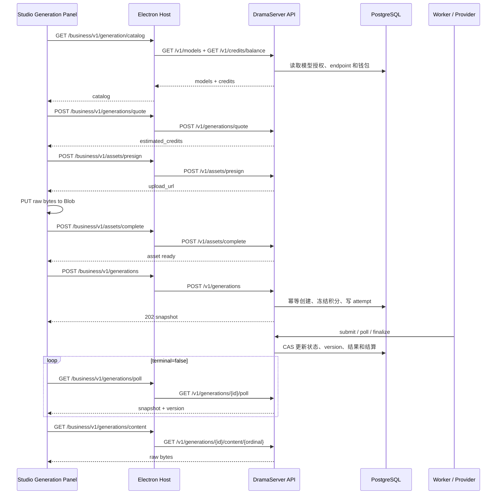

# DramaServer 业务 API

本文档说明以下业务接口的使用方式：

- `POST /v1/auth/sync`
- `GET /v1/models`
- `GET /v1/credits/balance`
- `GET /v1/billing/overview`
- `POST /v1/billing/checkout-sessions`
- `POST /v1/assets/presign`
- `POST /v1/assets/complete`
- `POST /v1/generations/quote`
- `POST /v1/generations`
- `GET /v1/generations/{id}`
- `GET /v1/generations/{id}/poll`
- `GET /v1/generations`
- `POST /v1/generations/{id}/cancel`
- `GET /v1/generations/{id}/content/{ordinal}`
- `POST /v1/webhooks/providers/playsout/accounts/{provider_account_id}`

M8 generation endpoints require a Supabase access token. Create also requires a
session-bound token, `Idempotency-Key`, and returns HTTP `202`; request bodies
use `model`, `operation`, `input`, and optional `inputs[]` with `asset_id`.
Quote uses the same `model`, `operation`, and `input` fields, returns HTTP `200`,
and only reports `estimated_credits` without creating a task or freezing credits.
Supported operations are `txt2image`, `image2image`, `image2character`,
`image2vl`, `video2vl`, `asr2txt`, `txt2audio`, `txt2speech`,
`image2videofl2va`, and `image2videoref2va`. `image2character` uses exactly one
uploaded character reference and does not require `input.prompt`.
`image2vl` and `video2vl` use one uploaded image or video plus
`input.prompt` and optional `input.system_prompt`, and return text through
`outputs[].text`. `asr2txt` uses one uploaded audio or video file without an
`input` object and returns a structured JSON output containing `txt`,
`txt_word`, and `txt_segment`.
Image generation bills `txt2image` and `image2image` by target
`width × height` for the single requested output in megapixels.
Minimax H3 video generation is submitted through `video.minimax_h3`.
`image2videofl2va` accepts optional first-frame and last-frame images;
`image2videoref2va` accepts up to nine images, three videos, and three audio
references. Both accept `aspect`, `megapixels`, and `duration`, and return a
video output through the protected content endpoint. Supported `aspect` values
are `16:9`, `9:16`, and `1:1`.
Audio creation uses `input.prompt` for the
music/style caption and optional
`lyrics`, `duration`, `bpm`, `key_scale`, `language`, and `time_signature`
fields. Speech creation uses `input.prompt` (alias `txt_prompt`) for the text
to synthesize, optional `input.system_prompt` (alias `instruct_prompt`) for
voice direction, and an optional single `audio` input as the VoxCPM2 reference
voice. The complete client contract is in
`docs/generation-client-api.md`.
Status reads never call the Provider. `/poll` accepts
`after_version` and `wait` (maximum `25s`) and always returns HTTP `200` for an
ordinary wait timeout. Raw Provider URLs are never returned; output bytes are
served only by the authenticated content endpoint under the M8 verification
contract in `docs/m8-verification.md`.

这些接口属于 DramaServer 业务 API，不负责 Supabase 登录。客户端应先通过
Supabase 完成登录或刷新会话，取得 `access_token`，再调用这些接口。

桌面客户端生成页不直接持有或发送 `access_token`。Studio 渲染层只请求同源的
`/business/v1/generation/*`、`/business/v1/generations/*` 和
`/business/v1/assets/*`，由 Electron Host 注入当前会话并转发到本文的
`/v1/*` 接口。完整接口规范见第 6 节，桌面端调用流程见第 7 节。

## 1. 公共约定

### 1.1 服务地址

本地默认地址：

```text
http://127.0.0.1:8080
```

实际地址由 `API_ADDR` 和部署环境决定。下文使用 `<BASE_URL>` 表示 API 根地址。

### 1.2 认证

所有请求都必须携带 Supabase access token：

```http
Authorization: Bearer <supabase-access-token>
Accept: application/json
```

服务端会校验 JWT 的签名、算法、`iss`、`aud`、`exp` 和 `nbf`，并要求 `sub`
是 UUID。业务用户 ID 来自 JWT 的 `sub`，客户端不能在请求体中指定其他用户。

每次认证请求都会确保当前业务用户已存在。用户状态不是 `active` 时返回
`403 permission_denied`。

### 1.3 限流

- `POST /v1/auth/sync`：认证前按 IP 限流 `600 次/分钟`，认证后按用户限流
  `600 次/分钟`。
- 其他已认证接口：按用户限流 `600 次/分钟`。
- 成功和失败响应通常带有 `X-RateLimit-Limit` 和 `X-RateLimit-Remaining`。
- 触发限流时返回 `429 rate_limited`，并带 `Retry-After` 响应头。
- Redis 不可用时采用 fail-open 策略。

### 1.4 错误响应

错误统一使用以下信封：

```json
{
  "error": {
    "code": "invalid_argument",
    "message": "具体错误信息"
  }
}
```

客户端应依据 `error.code` 做业务判断，不要依赖 `message` 文案。

常见错误码：

| HTTP | `error.code` | 说明 |
| --- | --- | --- |
| 400 | `invalid_argument` | JSON、设备字段或查询参数非法 |
| 401 | `unauthenticated` | 缺少、过期或非法 token；敏感操作缺少 `session_id` |
| 403 | `permission_denied` | 当前业务用户已被禁用 |
| 429 | `rate_limited` | 触发 IP 或用户限流 |
| 500 | `internal` | 服务端内部错误 |
| 503 | `unavailable` | JWT/JWKS 等依赖不可用 |

### 1.5 推荐调用顺序

1. 通过 Supabase 登录，取得 access token。
2. 调用 `POST /v1/auth/sync`，同步业务用户并登记当前设备。
3. 调用 `GET /v1/models` 获取可用模型。
4. 调用 `GET /v1/credits/balance` 获取当前积分余额。
5. 使用模型调用后续生成或 LLM 接口。

## 2. POST /v1/auth/sync

### 2.1 用途

登录后的 bootstrap 接口：

- 幂等创建或读取当前业务用户。
- 可选登记当前桌面设备。
- 重复调用不会创建重复用户或重复设备。

### 2.2 请求

```http
POST /v1/auth/sync
Authorization: Bearer <supabase-access-token>
Content-Type: application/json
Accept: application/json
```

请求体可以完全省略，也可以传空对象 `{}`。

带设备登记的请求体：

```json
{
  "device": {
    "device_id": "desktop-installation-id",
    "name": "Studio Mac",
    "platform": "darwin",
    "app_version": "1.0.0"
  }
}
```

字段说明：

| 字段 | 必填 | 说明 |
| --- | --- | --- |
| `device` | 否 | 省略时只同步用户 |
| `device.device_id` | 是 | 设备稳定标识；去除首尾空格后长度为 `1~200` |
| `device.name` | 否 | 设备名称，长度上限按 UTF-8 字节计算 |
| `device.platform` | 否 | 平台，例如 `darwin`、`win32`、`linux` |
| `device.app_version` | 否 | 客户端版本 |

请求约束：

- 请求体最大 1 MiB。
- JSON 中不允许未知字段。
- 请求体只能包含一个 JSON 值。
- JSON 格式错误或字段非法时返回 `400 invalid_argument`。

### 2.3 会话要求

- 不带 `device`：只要求合法 JWT，不要求 JWT 包含 `session_id`。
- 带 `device`：JWT 必须包含非空 `session_id`，否则返回
  `401 unauthenticated`。普通 Supabase 登录 access token 通常满足该条件。

### 2.4 行为

- `sub` 对应的业务用户不存在时自动创建。
- 已验证 JWT 中的 `email` 会同步到业务用户记录，用于后台支持检索。
- 用户已存在时复用已有记录，并更新发生变化的展示资料和邮箱。
- `(user_id, device_id)` 唯一。
- 重复登记同一 `device_id` 时更新设备信息、`last_seen_at` 和 `updated_at`。
- 已撤销设备再次登记后会重新变为 `active`。
- 重复登记会覆盖设备字段，建议每次发送完整设备信息。省略的可选字段会被置空。
- 客户端应为同一安装生成并持久化稳定的 `device_id`，不要每次启动重新生成。

### 2.5 成功响应

HTTP `200 OK`：

```json
{
  "user": {
    "id": "99999999-9999-4999-8999-000000000001",
    "display_name": "Alice",
    "avatar_url": "https://example.com/avatar.png",
    "email": "alice@example.com",
    "status": "active",
    "locale": "en",
    "created_at": "2026-10-19T10:00:00Z",
    "updated_at": "2026-10-19T10:00:00Z"
  },
  "device": {
    "id": "aaaaaaaa-aaaa-4aaa-8aaa-000000000001",
    "user_id": "99999999-9999-4999-8999-000000000001",
    "device_id": "desktop-installation-id",
    "name": "Studio Mac",
    "platform": "darwin",
    "app_version": "1.0.0",
    "status": "active",
    "last_seen_at": "2026-10-19T10:00:00Z",
    "created_at": "2026-10-19T10:00:00Z",
    "updated_at": "2026-10-19T10:00:00Z"
  }
}
```

不提交设备时：

```json
{
  "user": {
    "id": "99999999-9999-4999-8999-000000000001",
    "status": "active",
    "locale": "en",
    "created_at": "2026-10-19T10:00:00Z",
    "updated_at": "2026-10-19T10:00:00Z"
  },
  "device": null
}
```

`display_name`、`avatar_url`、`email` 以及设备可选字段为空时可能直接省略。

### 2.6 错误码

| HTTP | `error.code` | 场景 |
| --- | --- | --- |
| 400 | `invalid_argument` | JSON 非法、未知字段、`device_id` 缺失或字段超长 |
| 401 | `unauthenticated` | token 缺失或非法；带设备但 token 无 `session_id` |
| 403 | `permission_denied` | 当前用户已禁用 |
| 429 | `rate_limited` | IP 或用户限流 |
| 500 | `internal` | 数据写入或服务端内部错误 |
| 503 | `unavailable` | JWT/JWKS 不可用 |

## 3. GET /v1/models

### 3.1 用途

查询当前用户有权访问的模型目录，包括模型能力、授权状态、可用状态和可路由端点。

### 3.2 请求

```http
GET /v1/models
Authorization: Bearer <supabase-access-token>
Accept: application/json
```

可选查询参数：

| 参数 | 必填 | 可选值 | 说明 |
| --- | --- | --- | --- |
| `modality` | 否 | `image`、`video`、`audio`、`text` | 按模型模态过滤 |

示例：

```http
GET /v1/models?modality=text
GET /v1/models?modality=image
```

`modality` 只接受上述小写值。未知值或大小写不匹配返回
`400 invalid_argument`。

### 3.3 成功响应

HTTP `200 OK`：

```json
{
  "models": [
    {
      "id": "55555555-5555-4555-8555-000000000001",
      "code": "image.nano_banana.pro",
      "display_name": "Nano Banana Pro",
      "modality": "image",
      "capabilities": {
        "inputs": ["text", "image"],
        "outputs": ["image"]
      },
      "entitled": true,
      "available": true,
      "created_at": "2026-10-15T12:00:00Z",
      "endpoints": [
        {
          "id": "66666666-6666-4666-8666-000000000001",
          "provider_code": "fal",
          "provider_name": "fal.ai",
          "endpoint_type": "fal.queue.image",
          "region": "us-east-1",
          "status": "active",
          "available": true
        }
      ]
    }
  ],
  "entitlement": {
    "plan_code": "starter_monthly",
    "features": {
      "concurrent_generations": 2
    },
    "models": ["image.*"]
  }
}
```

### 3.4 字段说明

模型字段：

| 字段 | 说明 |
| --- | --- |
| `id` | 模型 UUID |
| `code` | 模型稳定编码，后续请求使用该值 |
| `display_name` | 展示名称 |
| `modality` | `image`、`video`、`audio` 或 `text` |
| `capabilities` | 模型能力，结构由目录配置决定 |
| `context_window` | 可选。请求与响应合计可用的 token 上限；未声明时省略 |
| `max_output_tokens` | 可选。单次响应输出 token 上限；未声明时省略 |
| `entitled` | 是否已授权；正常返回的模型均为 `true` |
| `available` | 是否至少有一个 endpoint 可路由 |
| `created_at` | 模型目录记录创建时间 |
| `endpoints` | 模型的可路由端点列表 |

容量字段是 token 数，不是字节数。`context_window` 表示完整上下文窗口，
并不等同于 `max_output_tokens`；后者只限制生成输出。

端点字段：

| 字段 | 说明 |
| --- | --- |
| `id` | endpoint UUID |
| `provider_code` | provider 编码 |
| `provider_name` | provider 名称 |
| `endpoint_type` | endpoint 类型 |
| `region` | 区域，可能省略 |
| `status` | endpoint 状态 |
| `available` | 当前 endpoint 是否可路由 |

### 3.5 授权与可用性

- 响应只包含 active 且被当前用户 entitlement 允许的模型。
- 返回模型中的 `entitled` 通常都是 `true`。
- 没有 active subscription 时，默认允许全部 active 模型。
- entitlement 的 `models` 支持精确匹配、`*` 和前缀通配，例如 `image.*`。
- `entitlement.models` 省略或为空表示不限制模型。
- `entitlement.features` 始终是 JSON 对象。
- 没有套餐时，`plan_code` 和 `models` 可能省略。
- 不可用的模型仍可能出现在列表中，应判断 `available`，不能只根据数组是否存在来判断。
- endpoint 可用要求：endpoint 为 active、provider 为 active，且 provider 至少有一个
  active account。
- 接口不分页，返回全部匹配结果。
- `models` 为空时返回 `[]`，不是 `null`。

### 3.6 错误码

| HTTP | `error.code` | 场景 |
| --- | --- | --- |
| 400 | `invalid_argument` | `modality` 不在允许集合内 |
| 401 | `unauthenticated` | token 缺失或非法 |
| 403 | `permission_denied` | 当前用户已禁用 |
| 429 | `rate_limited` | 用户限流 |
| 500 | `internal` | 目录或数据库查询失败 |
| 503 | `unavailable` | JWT/JWKS 不可用 |

## 3.7 POST /v1/generations/quote

### 3.7.1 用途

在创建生成任务前计算当前模型、operation 和参数对应的预计积分消耗。报价使用
与创建任务相同的路由选择和价格公式，但不会创建任务、写入 attempt 或冻结积分。

```http
POST /v1/generations/quote
Authorization: Bearer <supabase-access-token>
Content-Type: application/json

{
  "model": "image.qwen-image-2.1",
  "operation": "txt2image",
  "input": {
    "width": 1280,
    "height": 720
  }
}
```

请求体支持与创建任务相同的 `model`、`operation` 和 `input`。报价阶段不要求
`Idempotency-Key`，也不要求 prompt 或待上传素材已经就绪。

### 3.7.2 成功响应

HTTP `200 OK`：

```json
{
  "estimated_credits": 18.432
}
```

`estimated_credits` 是当前有效价格版本计算后的预计冻结积分，最多保留四位
小数。最终冻结和结算金额仍以 `POST /v1/generations` 创建任务时的服务端结果为准。

## 4. GET /v1/credits/balance

### 4.1 用途

查询当前用户的积分余额和构成余额的 active 批次。

### 4.2 请求

```http
GET /v1/credits/balance
Authorization: Bearer <supabase-access-token>
Accept: application/json
```

该接口没有查询参数和请求体。

### 4.3 成功响应

HTTP `200 OK`：

```json
{
  "currency": "credit",
  "available_balance": 1350.0000,
  "frozen_balance": 250.0000,
  "lots": [
    {
      "id": "aaaaaaaa-aaaa-4aaa-8aaa-000000000001",
      "source": "signup",
      "granted": 1000.0000,
      "remaining": 850.0000,
      "expires_at": "2026-11-14T12:00:00Z",
      "status": "active",
      "created_at": "2026-10-15T12:00:00Z"
    }
  ]
}
```

### 4.4 字段说明

| 字段 | 说明 |
| --- | --- |
| `currency` | 积分币种，当前通常为 `credit` |
| `available_balance` | 当前可立即使用的积分 |
| `frozen_balance` | 已被进行中的生成或 LLM 请求冻结的积分 |
| `lots` | 构成当前余额的 active 积分批次 |

批次字段：

| 字段 | 说明 |
| --- | --- |
| `id` | 批次 UUID |
| `source` | 批次来源 |
| `granted` | 最初发放数量 |
| `remaining` | 当前剩余数量 |
| `expires_at` | 过期时间，可能省略 |
| `status` | 当前状态，余额接口只返回 active 批次 |
| `created_at` | 批次创建时间 |

`source` 的可能取值：

- `signup`
- `subscription`
- `topup`
- `promotion`
- `adjustment`

### 4.5 余额语义

- `available_balance + frozen_balance` 等于 active 批次 `remaining` 之和。
- `frozen_balance` 是尚未结算的在途冻结额，不是已消费积分。
- `remaining` 包含该批次中被冻结的部分。
- 批次按消费顺序返回：先按到期时间，再按创建时间。
- 已过期、已扣完或已关闭的批次不会出现在余额响应中。
- 需要查看发放、冻结、提交、释放、过期和调账记录时，使用
  `GET /v1/credits/ledger`。
- 本接口不返回模型价格或单次请求成本。

### 4.6 金额格式

所有金额字段都是 JSON number，并固定保留 4 位小数：

```json
{
  "available_balance": 1350.0000,
  "frozen_balance": 250.0000,
  "granted": 1000.0000,
  "remaining": 850.0000
}
```

客户端应按小数处理，不要截断为整数。

### 4.7 首次访问

用户首次访问余额时，服务端可能懒创建钱包。如果配置了
`BILLING_SIGNUP_CREDITS`，还会幂等发放一次注册积分。重复调用不会重复发放。

### 4.8 错误码

| HTTP | `error.code` | 场景 |
| --- | --- | --- |
| 401 | `unauthenticated` | token 缺失或非法 |
| 403 | `permission_denied` | 当前用户已禁用 |
| 429 | `rate_limited` | 用户限流 |
| 500 | `internal` | 钱包、批次或账务查询失败 |
| 503 | `unavailable` | JWT/JWKS 不可用 |

## 5. 订阅与积分 API

### 5.1 GET /v1/billing/overview

用途：一次返回当前用户的订阅、积分、进行中的 Checkout 和可售商品。

请求：

```http
GET /v1/billing/overview
Authorization: Bearer <supabase-access-token>
Accept: application/json
```

该接口不要求 Supabase `session_id`。成功响应包含：

- `subscription`：当前或最近一次订阅摘要，没有订阅时为 `null`
- `credits`：可用积分、冻结积分和积分币种
- `pending_checkout`：当前未完成的 Checkout；状态可为 `creating`、`open` 或
  `awaiting_payment`，为空时不影响套餐购买
- `plans`：当前可展示的订阅套餐
- `credit_packs`：当前可展示的积分包

商品中的 `purchasable` 表示当前用户此刻是否可购买。缺少 Stripe Price 映射、
已有 active 订阅或已有订阅 Checkout 时会返回 `false`。

示例：

```json
{
  "subscription": {
    "status": "active",
    "provider_status": "trialing",
    "provider": "stripe",
    "plan_code": "creator_monthly",
    "plan_name": "Creator",
    "billing_period": "month",
    "period_credits": 8000.0000,
    "current_period_start": "2026-10-27T00:00:00Z",
    "current_period_end": "2026-11-27T00:00:00Z",
    "cancel_at_period_end": false
  },
  "credits": {
    "currency": "credit",
    "available_balance": 1200.0000,
    "frozen_balance": 20.0000
  },
  "plans": [],
  "credit_packs": []
}
```

`provider_status` 保留 Stripe 原始订阅状态；桌面端应优先展示该值，并把本地
`status` 作为访问控制状态。`provider=stripe` 表示该订阅支持打开 Customer Portal；
`manual` 订阅不显示自动管理入口。

`cancel_at_period_end=true` 表示已计划在当前周期结束取消。Stripe 事件中的非空
`cancel_at` 也会同步为该值，此时订阅仍可继续使用到 `current_period_end`。
用户在 Customer Portal 重新激活后，这两个字段会被清除，响应恢复为自动续费。

### 5.2 POST /v1/billing/checkout-sessions

用途：创建本地待支付订单和 Stripe Checkout Session。

该接口要求：

- 有效的 Supabase access token
- token 中包含 `session_id`
- 必填请求头 `Idempotency-Key`
- 请求体最大 16 KiB
- 不接受未知 JSON 字段

请求：

```http
POST /v1/billing/checkout-sessions
Authorization: Bearer <supabase-access-token>
Idempotency-Key: 3dbf7ad8-ef58-4b4f-8f9d-0cb36514db56
Content-Type: application/json

{
  "kind": "plan",
  "product_code": "creator_monthly"
}
```

`kind` 只允许：

- `plan`
- `credit_pack`

成功返回 HTTP `201`：

```json
{
  "order_id": "aaaaaaaa-aaaa-4aaa-8aaa-aaaaaaaaaaaa",
  "order_no": "RB202610270001",
  "checkout_session_id": "cs_test_...",
  "checkout_url": "https://checkout.stripe.com/...",
  "expires_at": "2026-10-27T12:30:00Z"
}
```

桌面端只应打开返回的 `checkout_url`，不得自行拼接金额或 Stripe Price ID。
相同幂等键和相同请求会返回原 Checkout；相同幂等键但请求变化返回 `409 conflict`。

常见错误：

| HTTP | 场景 |
| --- | --- |
| 400 | JSON/kind/product_code/Idempotency-Key 非法，或请求体过大 |
| 401 | token 缺失、无效或缺少 session |
| 403 | 用户不可购买 |
| 404 | 商品记录不存在 |
| 409 | 商品不可售、已有 active 订阅、已有订阅 Checkout、延迟支付确认中或幂等冲突 |
| 503 | Stripe 未配置、拒绝请求或暂时不可用 |

### 5.3 POST /v1/billing/portal-sessions

用途：为当前用户已有的 Stripe 订阅创建短时 Customer Portal Session。

该接口要求：

- 有效的 Supabase access token
- token 中包含 `session_id`
- 当前用户存在 Stripe Customer 映射和未进入 canceled/expired 的本地订阅

请求：

```http
POST /v1/billing/portal-sessions
Authorization: Bearer <supabase-access-token>
```

成功返回 HTTP `201`：

```json
{
  "portal_url": "https://billing.stripe.com/p/session/..."
}
```

桌面端只负责用系统浏览器打开 `portal_url`。用户在 Stripe Customer Portal
取消续费后，Stripe Webhook 将 `cancel_at_period_end` 同步为 `true`；周期结束后
订阅状态变为 `canceled`。客户端不得自行修改本地订阅状态。

服务端可通过 `PAYMENT_PORTAL_CONFIGURATION_ID` 指定 Stripe Portal 配置。该配置
必须启用订阅取消；一期若不允许升级或降级，应在 Stripe Dashboard 中关闭相关功能。

常见错误：

| HTTP | `error.code` | 场景 |
| --- | --- | --- |
| 401 | `unauthenticated` | token 缺失、无效或缺少 session |
| 403 | `permission_denied` | 用户不可用 |
| 409 | `portal_unavailable` | 没有可管理的 Stripe 订阅或 Customer 映射 |
| 503 | `unavailable` | Stripe 暂时不可用或 Portal 未配置 |

### 5.4 POST /v1/webhooks/stripe

该接口只供 Stripe 调用：

- 不使用用户 JWT。
- 必须带 `Stripe-Signature`。
- 原始请求体最大 1 MiB。
- 验签后持久化事件并写入 River。
- 业务履约只由 Webhook Worker 执行，成功返回 HTTP `200 {"received":true}`。

## 6. Generation API

### 6.1 分层边界

Generation 有两条合法调用路径：

| 调用方 | 入口 | 认证方式 | 用途 |
| --- | --- | --- | --- |
| Desktop Studio 渲染层 | `/business/v1/*` 同源路由 | 外壳注入 renderer token 和 session cookie | Electron 客户端正式集成 |
| 非 Electron 客户端、CLI、联调工具 | `/v1/*` DramaServer 路由 | `Authorization: Bearer <access-token>` | 直接调用业务 API |

Desktop 渲染层不得读取、保存或发送 Supabase access token，也不得绕过 Host 直接
访问 DramaServer。Host 负责：

- 校验渲染层 Origin、逐运行 renderer token 和 session cookie。
- 从会话管理器取得当前 access token。
- 将 `/business/v1/*` 请求转发为 DramaServer `/v1/*` 请求。
- 将上游错误转换为渲染层可处理的 `error.code` 和 HTTP 状态。
- 校验预签名上传地址，不把不可信 URL 交给渲染层。
- 不向渲染层返回 Provider 原始内容 URL 或 provider account；catalog 中可以
  包含 endpoint 摘要，但创建请求不能引用 endpoint 或 account。

### 6.2 路由总览

Desktop Host 路由与服务端路由的对应关系：

| Desktop Host 路由 | DramaServer 路由 | 成功状态 | 说明 |
| --- | --- | --- | --- |
| `GET /business/v1/generation/catalog` | `GET /v1/models` + `GET /v1/credits/balance` | `200` | 聚合全部 modality 的模型和积分 |
| `POST /business/v1/generations/quote` | `POST /v1/generations/quote` | `200` | 预估积分，不创建任务 |
| `POST /business/v1/generations` | `POST /v1/generations` | `202` | 创建生成任务 |
| `GET /business/v1/generations` | `GET /v1/generations` | `200` | 分页读取当前用户任务 |
| `GET /business/v1/generations/poll` | `GET /v1/generations/{id}/poll` | `200` | 长轮询任务版本 |
| `POST /business/v1/generations/cancel` | `POST /v1/generations/{id}/cancel` | `202` | 请求取消 |
| `GET /business/v1/generations/content` | `GET /v1/generations/{id}/content/{ordinal}` | `200` | 鉴权读取结果字节 |
| `POST /business/v1/assets/presign` | `POST /v1/assets/presign` | `201` | 创建素材直传 URL |
| `POST /business/v1/assets/complete` | `POST /v1/assets/complete` | `200` | 校验上传并激活素材 |

Host 查询参数是显式参数，不沿用服务端路径参数：

- 轮询：`GET /business/v1/generations/poll?id=<id>&after_version=<n>&wait=25s`
- 取消：`POST /business/v1/generations/cancel?id=<id>`
- 内容：`GET /business/v1/generations/content?id=<id>&ordinal=<n>`

Host 当前不单独暴露 `GET /business/v1/generations/{id}`。需要立即读取一个任务时，
生成页使用 `poll` 接口并传 `wait=0s`。

### 6.3 Desktop 传输约定

Studio 生成页使用相对路径：

```js
const response = await fetch('business/v1/generation/catalog', {
  headers: { accept: 'application/json' },
})
```

请求必须发往 Host 的同源地址。外壳会覆盖式注入以下凭据，渲染层不能伪造：

- `x-reelsbuddy-desktop-renderer`
- `reelsbuddy_desktop_session` cookie

如果带 `Origin`，Host 只接受当前渲染层白名单；同源 GET 可以不带 `Origin`。
Host 鉴权失败返回：

```json
{
  "error": "forbidden",
  "reason": "renderer_token_missing"
}
```

这不是 DramaServer 的标准错误信封。正常的业务错误仍为：

```json
{
  "error": {
    "code": "conflict",
    "message": "generation request conflicts with an existing request"
  }
}
```

所有 Host 业务响应都带 `Cache-Control: no-store`。

### 6.4 生成页 operation 矩阵

生成页根据 `GET /v1/models` 返回的 `capabilities.operations` 过滤可提交模型。
客户端不得根据模型名称硬编码 ability，也不得传 `model_id`、endpoint 或
provider account。

| operation | 页面功能 | 模型 modality | 输出 | 素材要求 | `input` 字段 |
| --- | --- | --- | --- | --- | --- |
| `txt2image` | 文生图 | `image` | image | 无 | `prompt`、`width`、`height` |
| `image2image` | 图生图 | `image` | image | 1-4 个 image | `prompt`、`width`、`height` |
| `image2character` | 角色四视图 | `image` | image | 恰好 1 个 image | 可省略；不需要 prompt |
| `image2vl` | 图像理解 | `image` | text | 恰好 1 个 image | `prompt`，可选 `system_prompt` |
| `video2vl` | 视频理解 | `video` | text | 恰好 1 个 video | `prompt`，可选 `system_prompt` |
| `image2videofl2va` | 首尾帧/文生视频 | `video` | video | 可选 0-2 个 image | `prompt`、`aspect`、`megapixels`、`duration` |
| `image2videoref2va` | 多模态参考生视频 | `video` | video | 可选 0-15 个 image/video/audio | `prompt`、`aspect`、`megapixels`、`duration` |
| `asr2txt` | 音频/视频识别 | `audio` | json | 恰好 1 个 audio 或 video | 不传 `input` |
| `txt2audio` | 文生音乐 | `audio` | audio | 无 | `prompt`、`lyrics`、`duration`、`bpm`、`key_scale`、`language`、`time_signature` |
| `txt2speech` | 语音合成 | `audio` | audio | 可选 1 个 audio | `prompt`、可选 `system_prompt` |

模型选择规则：

- `available` 必须为 `true`。
- `entitled` 不能为 `false`。
- `capabilities.operations` 必须包含当前 operation。
- `model` 使用模型稳定编码 `code`，例如 `image.qwen-image-2.1`。
- 目录未声明 `operations` 时，客户端至少应检查输入、输出能力；Desktop 生成页
  当前要求显式声明 operation。

### 6.5 请求体通用规范

创建和报价请求只使用以下顶层字段：

```json
{
  "model": "image.qwen-image-2.1",
  "operation": "txt2image",
  "input": {},
  "inputs": []
}
```

| 字段 | 必填 | 说明 |
| --- | --- | --- |
| `model` | 是 | `GET /v1/models` 返回的模型 `code` |
| `operation` | 是 | 6.4 中的 operation |
| `input` | 按 operation | 文本、尺寸、时长等生成参数 |
| `inputs` | 按 operation | 已上传且状态为 `ready` 的素材引用 |

公共约束：

- JSON 字段使用 `snake_case`。
- 请求体和嵌套 `input` 不接受未知字段。
- Generation JSON 请求体最大 1 MiB。
- Host 的 presign 和 complete 请求体各最大 16 KiB。
- `inputs[]` 每项只允许 `asset_id`、`role`、`ordinal`。
- 同一 role 的 `ordinal` 必须唯一、从 1 连续，且同一 asset 不能重复。
- `image2videoref2va` 最多 9 个 image、3 个 video、3 个 audio，总计不超过 15。
- `image2videofl2va` 的两个 image 按 `ordinal=1` 首帧、`ordinal=2` 尾帧解释。
- `txt2image`、`txt2audio` 不接受任何 `inputs`。
- `image2character` 不接受多个素材，也不要求 `input.prompt`。
- `asr2txt` 不传 `input`，只传 1 个 audio 或 video；`role` 必须与素材 MIME type 一致。
- `txt2speech` 的参考音频最多 1 个，`role` 必须为 `audio`。

图片尺寸与视频参数：

- `txt2image`、`image2image` 的 `width`、`height` 省略或传 `0` 时默认
  `1024 x 768`；显式值范围 `1..8192`。
- 两个 Minimax H3 operation 的 `aspect` 只能是 `16:9`、`9:16`、`1:1`，默认
  `16:9`。
- `megapixels` 默认 `0.4`，有效范围 `0.01..16`。
- 视频 `duration` 默认 `5` 秒，范围 `1..60`。
- 视频 operation 不接受 `width`、`height`、`system_prompt` 或音乐字段。

文本字段限制：

- `prompt` 对除 `image2character`、`asr2txt` 外的创建请求必填。
- 图片、视觉理解和视频 prompt 最大 8000 字节。
- `txt2audio`、`txt2speech` prompt 最大 20000 字节。
- `system_prompt` 最大 2000 字符。
- `lyrics` 可选，最大 100000 字节。
- `txt2audio.duration` 默认 `30` 秒，范围 `1..600`。
- `txt2audio.bpm` 默认 `128`，范围 `1..400`。
- `key_scale`、`language`、`time_signature` 默认分别为 `Bb major`、`en`、`4`，
  每项最多 80 字符。

标准字段与兼容别名：

- DramaServer 直连接口接受 `caption_prompt`、`lyrics_prompt`、`keyscale`、
  `timesignature`、`txt_prompt`、`instruct_prompt` 等 Playsout 兼容字段。
- 同一含义的标准字段和别名若同时出现，值必须一致，否则返回 `400`。
- Host `/business/v1/generations` 会拒绝这些别名，只接受标准字段。Desktop
  生成页统一使用标准字段。

### 6.6 素材上传规范

需要素材的 operation 必须先完成三段上传。Host 路由不把 access token 暴露给
渲染层。

#### 6.6.1 创建预签名

```http
POST /business/v1/assets/presign
Content-Type: application/json

{
  "type": "image",
  "filename": "reference.png",
  "content_type": "image/png",
  "size_bytes": 12345
}
```

成功返回 HTTP `201`：

```json
{
  "asset": {
    "id": "bbbbbbbb-bbbb-4bbb-8bbb-000000000002",
    "type": "image",
    "status": "uploading",
    "mime_type": "image/png",
    "expires_at": "2026-11-17T12:00:00Z",
    "created_at": "2026-11-15T12:00:00Z",
    "updated_at": "2026-11-15T12:00:00Z"
  },
  "upload_url": "https://...signed-put-url...",
  "headers": {
    "content-type": "image/png"
  },
  "expires_at": "2026-11-15T12:10:00Z"
}
```

`type` 只能是 `image`、`video`、`audio`。Desktop 支持的图片 MIME 包括
`image/jpeg`、`image/png`、`image/webp`、`image/gif`、`image/avif`；音频包括
`audio/mpeg`、`audio/mp4`、`audio/wav`、`audio/x-wav`、`audio/ogg`、
`audio/webm`；视频包括 `video/mp4`、`video/quicktime`、`video/webm`、
`video/x-matroska`。

Host 只接受 HTTPS，或 loopback HTTP 的 `upload_url`，且 URL 不能包含用户名和
密码。

#### 6.6.2 直传 Blob

```http
PUT <upload_url>
Content-Type: image/png

<raw image bytes>
```

必须原样使用 presign 返回的 `headers`。这个请求不需要 DramaServer access token，
也不应带 Host 的 session cookie 或 renderer token。

预签名不幂等。网络失败后如果重新调用 presign，会得到新的 asset ID 和对象键。

#### 6.6.3 完成上传

```http
POST /business/v1/assets/complete
Content-Type: application/json

{
  "asset_id": "bbbbbbbb-bbbb-4bbb-8bbb-000000000002",
  "checksum_sha256": "0123456789abcdef0123456789abcdef0123456789abcdef0123456789abcdef",
  "size_bytes": 12345
}
```

`checksum_sha256` 必须是原始文件字节 SHA-256 的小写或大写十六进制。成功返回
HTTP `200` 和 `status: "ready"` 的 asset。相同 checksum 重复 complete 幂等；
checksum 不一致返回 `409 conflict`。

只有当前用户、`ready`、未过期的素材可以作为 generation 输入。创建时遇到素材
问题：

| HTTP | `error.code` | 场景 |
| --- | --- | --- |
| `404` | `not_found` | 素材不存在、已清理或不属于当前用户 |
| `409` | `conflict` | 素材尚未 ready、角色不匹配或素材状态冲突 |
| `410` | `gone` | 素材已过期 |

### 6.7 报价

```http
POST /business/v1/generations/quote
Content-Type: application/json

{
  "model": "image.qwen-image-2.1",
  "operation": "txt2image",
  "input": {
    "width": 1280,
    "height": 720
  }
}
```

成功返回 HTTP `200`：

```json
{
  "estimated_credits": 18.432
}
```

报价规则：

- 不需要 `Idempotency-Key`。
- 不需要 prompt 已填写，也不需要素材已经 ready。
- Host 不向 DramaServer 转发请求中的 `inputs`，报价只使用 `model`、`operation`
  和 `input`；如果请求仍带 `inputs`，Host 会先校验其结构再剔除。
- 使用与创建相同的模型路由、endpoint 和价格公式。
- 不创建 generation、不写 attempt、不冻结积分。
- 图片按目标像素计费，视频和音乐按秒计费，理解、识别和语音合成按 request 计费。
- 结果最多保留四位小数；最终冻结金额以创建响应和钱包状态为准。

Desktop 生成页在模型、operation、尺寸、宽高比、megapixels 或时长变化后，
等待 300ms 再发起报价，并用 `AbortController` 丢弃过期响应。

### 6.8 创建任务

```http
POST /business/v1/generations
Content-Type: application/json
Idempotency-Key: 3dbf7ad8-ef58-4b4f-8f9d-0cb36514db56
X-Client-Run-ID: desktop-8a4ca9e7-9c41-4bc7-a48d-897c04a7e598

{
  "model": "image.qwen-image-2.1",
  "operation": "txt2image",
  "input": {
    "prompt": "a cinematic mountain village at sunrise",
    "width": 1024,
    "height": 768
  }
}
```

请求头：

| 请求头 | 必填 | Host 约束 |
| --- | --- | --- |
| `Content-Type` | 是 | 必须是 `application/json`，允许带 charset |
| `Idempotency-Key` | 是 | trim 后 1-200 字节，只允许可打印 ASCII |
| `X-Client-Run-ID` | 否 | trim 后最多 255 字节，不能含控制字符 |

直连 DramaServer 时 `Idempotency-Key` 最大 255 字节。`X-Client-Run-ID` 只用于
服务端关联和排障，不能替代 generation ID，也不能作为列表恢复主键。

幂等语义：

- 同一用户、同一 key、同一规范化请求返回原 generation，不重复冻结积分或入队。
- 同一 key 但 model、operation、prompt、尺寸、时长或素材发生变化返回
  `409 conflict`。
- 创建响应丢失时，客户端必须复用原 key 和原 body 重试。
- 不能因为 `409 conflict` 自动换 key 重试，必须先核对已保存的创建意图。

成功返回 HTTP `202`：

```json
{
  "id": "aaaaaaaa-aaaa-4aaa-8aaa-000000000001",
  "model_id": "55555555-5555-4555-8555-000000000004",
  "operation": "txt2image",
  "status": "credit_held",
  "version": 1,
  "progress": 0,
  "billing_status": "held",
  "terminal": false,
  "poll_after_ms": 0,
  "outputs": [],
  "error": null,
  "created_at": "2026-11-15T12:00:00Z",
  "updated_at": "2026-11-15T12:00:00Z"
}
```

`202` 只表示任务已持久化并进入异步处理，不表示 Provider 已生成成功。

#### 6.8.1 带参考素材的创建示例

```json
{
  "model": "video.minimax_h3",
  "operation": "image2videoref2va",
  "input": {
    "prompt": "组合角色造型、镜头运动和音频情绪",
    "aspect": "16:9",
    "megapixels": 0.4,
    "duration": 5
  },
  "inputs": [
    { "asset_id": "bbbbbbbb-bbbb-4bbb-8bbb-000000000002", "role": "image", "ordinal": 1 },
    { "asset_id": "cccccccc-cccc-4ccc-8ccc-000000000003", "role": "video", "ordinal": 1 },
    { "asset_id": "dddddddd-dddd-4ddd-8ddd-000000000004", "role": "audio", "ordinal": 1 }
  ]
}
```

#### 6.8.2 ASR 创建示例

```json
{
  "model": "audio.fast-whisper",
  "operation": "asr2txt",
  "inputs": [
    {
      "asset_id": "dddddddd-dddd-4ddd-8ddd-000000000004",
      "role": "audio",
      "ordinal": 1
    }
  ]
}
```

### 6.9 查询、轮询、列表和取消

#### 6.9.1 立即查询

直连 DramaServer：

```http
GET /v1/generations/{id}
Authorization: Bearer <supabase-access-token>
```

只读取 PostgreSQL 快照，不调用 Provider。Desktop Host 没有对应的 path route；
生成页使用：

```http
GET /business/v1/generations/poll?id=<id>&after_version=0&wait=0s
```

#### 6.9.2 长轮询

```http
GET /business/v1/generations/poll?id=<id>&after_version=7&wait=25s
```

参数：

| 参数 | 默认 | 说明 |
| --- | --- | --- |
| `id` | 无 | generation UUID |
| `after_version` | `0` | 客户端已处理的最大版本 |
| `wait` | `25s` | Host 和服务端都限制到 `0..25s` |

行为：

- `terminal === true` 时立即返回 `200`。
- `version > after_version` 时立即返回 `200`。
- 否则最多等待 `wait`，期间服务端至少每秒重查 PostgreSQL。
- 普通等待超时仍返回 `200` 和最新快照，不返回 `408` 或 `504`。
- 客户端必须用响应中的新 `version` 更新游标，不能把 `progress` 或时间戳当游标。

#### 6.9.3 快照字段和状态

快照字段：

| 字段 | 说明 |
| --- | --- |
| `id` | generation UUID |
| `model_id` | 模型 UUID，仅供展示映射 |
| `operation` | 当前 generation operation |
| `status` | 任务状态 |
| `version` | 单调递增版本，轮询游标 |
| `progress` | `0..100` 展示进度 |
| `billing_status` | `none`、`held`、`committed`、`released` |
| `terminal` | 是否终态 |
| `poll_after_ms` | 普通轮询兼容字段；生成页优先使用长轮询 |
| `outputs` | 输出数组，无输出时为 `[]` |
| `error` | 无错误时为 `null` |
| `created_at` | 创建时间 |
| `updated_at` | 最近更新时间 |

状态：

| 状态 | 终态 | 说明 |
| --- | --- | --- |
| `created` | 否 | 已持久化，零价格任务尚未产生 hold |
| `credit_held` | 否 | 积分已冻结，等待提交 |
| `queued` | 否 | Provider 排队中 |
| `submitted` | 否 | 已提交 Provider |
| `running` | 否 | Provider 生成中 |
| `finalizing` | 否 | Provider 已返回，服务端正在落结果和结算 |
| `succeeded` | 是 | 成功，输出可读取 |
| `failed` | 是 | 失败，查看 `error.code` |
| `cancel_requested` | 否 | 已请求取消，等待 Provider 收敛 |
| `canceled` | 是 | 已取消 |
| `timeout` | 是 | 超过 deadline |

`finalizing` 不是终态。客户端必须继续轮询到 `terminal === true`。

#### 6.9.4 列表与恢复

```http
GET /business/v1/generations?limit=30
```

可选参数：

| 参数 | 说明 |
| --- | --- |
| `status` | 合法任务状态 |
| `limit` | 默认 50，Host 接受 1-200 |
| `cursor` | 上一页返回的不透明 cursor |

响应：

```json
{
  "generations": [],
  "next_cursor": "eyJjcmVhdGVkX2F0Ijoi..."
}
```

结果按 `created_at DESC, id DESC` 返回。最后一页没有 `next_cursor`。

#### 6.9.5 取消

```http
POST /business/v1/generations/cancel?id=<id>
```

成功返回 HTTP `202` 和原任务的新快照。非终态任务会先进入
`cancel_requested`，客户端继续长轮询直到 `canceled`、`failed` 或
`succeeded`。任务已终态时返回原终态快照，不改变状态。

### 6.10 输出与内容下载

成功后的 `outputs[]`：

```json
[
  {
    "ordinal": 0,
    "type": "image",
    "mime_type": "image/png",
    "content_url": "/v1/generations/aaaaaaaa-aaaa-4aaa-8aaa-000000000001/content/0",
    "width": 1024,
    "height": 768
  }
]
```

视觉理解结果直接带文本：

```json
[
  {
    "ordinal": 0,
    "type": "text",
    "mime_type": "text/plain",
    "text": "画面中的人物站在窗边。"
  }
]
```

ASR 结果是结构化 JSON：

```json
[
  {
    "ordinal": 0,
    "type": "json",
    "mime_type": "application/json",
    "txt": "plain transcript",
    "txt_word": "word timestamps",
    "txt_segment": "segment timestamps"
  }
]
```

图片、音频、视频输出没有内联字节。`content_url` 是 DramaServer 的相对受保护
路径，不是公开 CDN 地址，也不是 Provider URL。

Desktop 生成页通过：

```http
GET /business/v1/generations/content?id=<id>&ordinal=0
Accept: */*
```

Host 转发到服务端并注入 access token，响应是原始文件字节，`Content-Type` 来自
输出 MIME。结果缺失、过期或 ordinal 不存在时返回 HTTP `410`，错误码 `gone`，
message 为 `result_expired`。

渲染层不能把受保护地址直接放到 ``、`<audio src>` 或 `<video src>`。
生成页先 fetch Blob，再使用 `URL.createObjectURL(blob)`；切换任务或卸载面板时
调用 `URL.revokeObjectURL`。

### 6.11 Host catalog 约定

```http
GET /business/v1/generation/catalog
```

Host 并行调用：

- `GET /v1/models`，不带 modality 过滤，由生成页按 operation 过滤。
- `GET /v1/credits/balance`。

响应：

```json
{
  "models": [],
  "credits": {
    "currency": "credit",
    "available_balance": 1350,
    "frozen_balance": 250,
    "lots": []
  },
  "error": null
}
```

任一上游请求失败时，Host 仍返回 HTTP `200`，失败部分使用空值，并在 `error`
中给出稳定错误：

```json
{
  "models": [],
  "credits": null,
  "error": {
    "code": "unavailable",
    "message": "generation provider route is unavailable",
    "status": 503,
    "retryAfterSeconds": null
  }
}
```

模型和积分两个请求独立结算。一个成功、一个失败时，生成页仍可使用成功部分，
同时展示 `error` 提示。

### 6.12 Generation 限流与错误处理

直连 DramaServer 的限流：

- 已认证业务接口共享每用户 `600 次/分钟`。
- `POST /v1/generations` 额外限制每用户 `10 次/分钟`。
- `POST /v1/assets/presign` 和 `POST /v1/assets/complete` 共享每用户
  `30 次/分钟`。
- Redis 不可用时限流 fail-open。

Host 不额外实现 generation 业务限流，但会透传上游 `429` 和 `Retry-After`。

常见错误：

| HTTP | `error.code` | 客户端处理 |
| --- | --- | --- |
| `400` | `invalid_argument` | 检查 JSON、operation、字段范围或 asset ID |
| `401` | `unauthenticated` | 重新登录或刷新 Host 会话 |
| `403` | `permission_denied` | 停止请求并提示模型无权限或账号禁用 |
| `403` | `forbidden` | Host 传输层鉴权失败，通常是客户端集成错误 |
| `404` | `not_found` | 任务或素材不存在、不属于当前用户 |
| `409` | `conflict` | 幂等冲突、素材未 ready、积分不足或状态冲突 |
| `410` | `gone` | 素材或结果已过期 |
| `413` | `invalid_argument` | 请求体超过 Generation 或素材上传限制 |
| `429` | `rate_limited` | 遵守 `Retry-After`，加入少量抖动 |
| `500` | `internal` | 记录请求 ID，稍后重试或联系支持 |
| `502` | `invalid_response` | Host 拒绝了不安全的上传 URL 或异常上游响应 |
| `503` | `unavailable` | 当前没有可路由 Provider，做有界退避 |

Host 无法连接 DramaServer 时，catalog 使用 `error.code=transport_error`、
`error.status=0`；其他 generation 请求表现为网络错误。客户端应保留当前展示
状态并做有界退避，不要清空历史或重复创建新幂等键。

## 7. Desktop 客户端 generation 调用流程

### 7.1 页面初始化

1. 读取 `window.reelsbuddy.authState()`。
2. 未登录时只展示登录入口；登录态变化后重置 catalog、历史、任务和 Blob URL。
3. 已登录时并行执行：
   - `GET /business/v1/generation/catalog`
   - `GET /business/v1/generations?limit=30`
4. 生成页从 catalog 中筛出 `available=true`、`entitled!=false` 且声明当前
   operation 的模型。
5. 当前 operation 没有模型时，自动切换到第一个有可用模型的 operation。
6. 当前模型不在新 operation 的模型列表中时，自动选中第一个匹配模型。
7. 从 `localStorage["reelsbuddy.generation.intent.v1"]` 读取未完成创建意图。
8. 如果 intent 已有 generation ID，立即调用
   `poll?id=<id>&after_version=<version>&wait=0s` 并开始 follow；否则展示
   “继续上次提交”，允许用户用原 key 和原 body 重试。

### 7.2 表单与报价

生成页根据 operation 切换控件：

- 图片：prompt、系统提示词和/或参考文件。
- 视频：prompt、首尾帧或三类参考素材、`aspect`、`megapixels`、`duration`。
- 音乐：prompt、歌词、时长、BPM、调性、语言、拍号。
- 语音：朗读文本、可选语气提示和可选参考音频。
- ASR：只选择 1 个音频或视频，不显示 prompt。

报价请求只发送 `model`、`operation` 和当前表单的 `input`，不发送 `inputs`：

```js
const quoteBody = {
  model: selectedModel.code,
  operation,
  input: buildGenerationInput(operation, form),
}

await debounce(300)
await fetch('business/v1/generations/quote', {
  method: 'POST',
  headers: {
    accept: 'application/json',
    'content-type': 'application/json',
  },
  body: JSON.stringify(quoteBody),
})
```

`input` 可能包含当前 prompt、歌词和价格参数；服务端不会用 prompt 计算价格，
但会校验其类型和长度。Host 会从报价请求中剔除 `inputs`，因此不必等待素材
上传完成。模型、operation、宽、高、宽高比、megapixels 或时长变化后重新报价。
报价失败不应阻止用户提交，但最终提交结果必须以创建响应为准。

### 7.3 素材上传

文件选择后先做客户端类型和数量预检，再按文件逐个上传：

1. `POST /business/v1/assets/presign`
2. 向 `upload_url` 发 `PUT`，原样使用 `headers`
3. 计算 SHA-256
4. `POST /business/v1/assets/complete`
5. 只在响应 `status === "ready"` 时记录 `asset_id`

生成页按文件实例缓存上传结果，避免同一页面内重复上传。切换 operation 时清空
文件、上传缓存和已创建对象 URL。

上传完成后构造：

```js
const inputs = assets.map((asset) => ({
  asset_id: asset.id,
  role: asset.kind, // image | video | audio
  ordinal: nextOrdinalByRole[asset.kind]++,
}))
```

### 7.4 创建意图与幂等恢复

创建前先构造最终请求体，并计算稳定的 JSON fingerprint。生成页持久化：

```js
{
  key: crypto.randomUUID(),
  clientRunId: `desktop-${crypto.randomUUID()}`,
  fingerprint: JSON.stringify(body),
  body,
  createdAt: new Date().toISOString(),
  id?: generationId,
  version?: generationVersion
}
```

接口请求：

```js
const created = await fetch('business/v1/generations', {
  method: 'POST',
  headers: {
    accept: 'application/json',
    'content-type': 'application/json',
    'idempotency-key': intent.key,
    'x-client-run-id': intent.clientRunId,
  },
  body: JSON.stringify(intent.body),
}).then(readJSONOrThrow)
```

规则：

- 写入 intent 必须在 POST 前完成。
- 创建超时或响应丢失时，复用同一个 key、body 和 client run ID。
- 创建成功后将 `id`、`version` 写回 intent，再开始轮询。
- 参数或素材变化时，旧 intent 不再适用于新提交，必须生成新 key。
- 任务终态后清理对应 intent。
- 不把 `Idempotency-Key` 写到日志可见的 URL、分析事件或文件路径中。

### 7.5 长轮询

推荐循环：

```js
let current = created
let retryDelay = 500

while (!current.terminal && stillCurrentTask(current.id)) {
  try {
    current = await requestJSON(
      `business/v1/generations/poll?id=${encodeURIComponent(current.id)}` +
        `&after_version=${current.version}&wait=25s`,
    )
    retryDelay = 500
  } catch (error) {
    const retriable =
      error.status === 0 ||
      error.status === 429 ||
      error.status === 503 ||
      error.status >= 500
    if (!retriable || retryDelay > 12000) throw error

    const wait = error.retryAfterSeconds
      ? error.retryAfterSeconds * 1000
      : retryDelay
    await sleep(wait + Math.random() * 250)
    retryDelay = Math.min(retryDelay * 2, 12000)
  }
}
```

Desktop 生成页还使用每个 generation 的递增 poll token 取消旧循环。用户切换
任务、退出登录或面板卸载后，旧请求即使返回也不能覆盖新选择。

### 7.6 终态处理

`terminal === true` 后：

1. 将终态快照合并进历史。
2. 刷新 catalog，更新余额。
3. 重新读取最近 30 条历史。
4. 清理本次 intent。
5. 仅当 `status === "succeeded"` 且选中当前任务时，下载有 `content_url` 的输出。
6. 并行 fetch 所有二进制输出，逐个创建 object URL。
7. 任务切换或面板卸载时 revoke 所有 object URL。
8. `failed`、`timeout`、`canceled` 不下载输出，展示状态和 `error.message`。

### 7.7 取消和恢复

取消：

1. 仅在任务非终态且没有其他提交/取消操作进行中时允许取消。
2. `POST /business/v1/generations/cancel?id=<id>`。
3. 用返回快照替换当前任务。
4. 继续长轮询，不能把 `cancel_requested` 当作终态。

应用重启后：

- 历史任务通过列表恢复。
- 未终态任务通过保存的 generation ID 和 version 恢复长轮询。
- 没有 generation ID 但已有完整 intent 的任务通过原 key 和 body 重放创建。
- 列表不提供 `client_run_id` 过滤，因此 client run ID 不能作为恢复主键。

### 7.8 完整时序



### 7.9 Desktop 验收清单

- 登录后 catalog 成功加载全部 modality；模型按 `operations` 过滤。
- 模型或 operation 不匹配时不能提交。
- 报价 300ms 防抖，切换参数后旧报价不会覆盖新报价。
- 图片、视频和音频上传使用正确的 `type`、`content_type` 和 SHA-256。
- 上传请求不携带 Supabase token。
- 同一创建意图只在 POST 前生成一个幂等键，网络重试复用该 key。
- 响应丢失后不会重复冻结积分。
- 只使用 `/poll` 的 `version` 推进游标，等待不超过 25 秒。
- `finalizing` 和 `cancel_requested` 不被当成终态。
- 长轮询网络错误按 0/429/503/5xx 有界退避，4xx 业务错误停止。
- 终态后才下载结果；文本和 ASR JSON 不调用 content endpoint。
- 切换任务后旧 poll 和旧结果不能覆盖当前 UI。
- 对象 URL 在任务切换和卸载时释放。
- 结果过期 `410 gone` 有稳定提示。
- 渲染层不使用 access token、Provider URL、endpoint 或 account 构造生成请求。

## 8. 调用示例

以下 TypeScript 示例展示完整调用顺序。

```ts
const baseUrl = 'http://127.0.0.1:8080'
const headers = {
  Authorization: `Bearer ${accessToken}`,
  Accept: 'application/json',
}

const syncResponse = await fetch(`${baseUrl}/v1/auth/sync`, {
  method: 'POST',
  headers: {
    ...headers,
    'Content-Type': 'application/json',
  },
  body: JSON.stringify({
    device: {
      device_id: stableInstallationId,
      name: 'ReelsBuddy Desktop',
      platform: 'win32',
      app_version: '1.0.0',
    },
  }),
})

if (!syncResponse.ok) {
  throw new Error(`auth/sync failed: HTTP ${syncResponse.status}`)
}

const sync = await syncResponse.json()

const modelsResponse = await fetch(
  `${baseUrl}/v1/models?modality=text`,
  { headers },
)

if (!modelsResponse.ok) {
  throw new Error(`models failed: HTTP ${modelsResponse.status}`)
}

const models = await modelsResponse.json()

const balanceResponse = await fetch(`${baseUrl}/v1/credits/balance`, {
  headers,
})

if (!balanceResponse.ok) {
  throw new Error(`credits failed: HTTP ${balanceResponse.status}`)
}

const balance = await balanceResponse.json()
```

## 9. 通用错误处理建议

| 情况 | 建议 |
| --- | --- |
| `401 unauthenticated` | 刷新或重新获取 Supabase access token 后重试 |
| `403 permission_denied` | 停止业务请求并提示账号被禁用 |
| `400 invalid_argument` | 检查 JSON、`device_id`、`modality` 等输入 |
| `429 rate_limited` | 读取 `Retry-After`，等待后重试 |
| `503 unavailable` | 稍后重试，并避免高频重试 |
| `500 internal` | 记录请求 ID 和服务端日志，不要仅依赖错误文案 |
