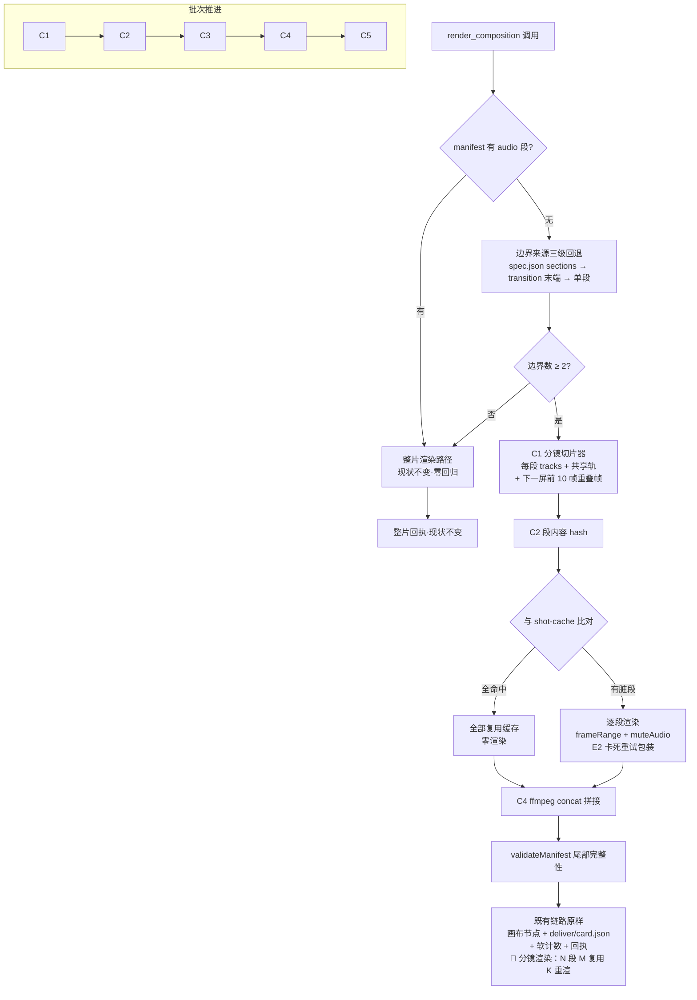

# REQ-038 · R11 需求增补 · 分镜渲染架构（Phase 1）

> **无人值守执行文档** · 2026-11-15 · 依据：真机首验（会话 a5087214）+ 参照拆解（毅见alpha 232s 信息流爆款）+ 用户提案「按分镜组织内容」+ 2026-11-14/15 两轮对话全量。
> 状态：**D1–D5 已按建议拍板，本文档可直接无人值守推进**。用户审核通过后开工。

---

## 0. 位置与基线

- 仓库：`/Users/wl/Desktop/job/learn/video_buddy`（开发 checkout；运行时 checkout `~/Desktop/job/git/playsout/videobuddytest`，本批不碰）
- 分支 dev；HEAD **4e4130b8f7**；**origin/dev 已同步（0 未推——用户已 push 全部 17 commits）**
- 包目录：`canvas-studio/`；本地全量门禁 `corepack yarn check` = typecheck + gen-manifest-fields --check + build + verify:loader + test:smoke（当前全绿，实测 41–110s）
- 真机首验已完成（会话 a5087214，20s 三屏 spec 通道）：机制层全 PASS（planStages 零离散 / 密度 2.3 轨每秒 / 零 lint / 零红卡 / deliver+card.json / 软计数 / 时长断言）

## 1. 已完成，不要重做

- **R7 五档**：B1 planStages 屏数原语（autoStages + 单屏可行带 + TTS 吸附）/ B2 screen-plan.md 分册 + R3.5 / B3 闸拆 stageSeconds/totalSeconds / C2 motion-lint 同类合并 / B4 段间转场（STAGE_TRANSITION_FRAMES=10，转场窗归前段语义已定）
- **R8 两批**：A1 格位相交分级校验（5%/overlap:true）/ A2+A3 scaffold 回执前置体检 / B+C 渲染期指引与 pitfalls §10 / E1 放手跑顺序门自动代办 / E2 渲染卡死有界自动重试 / E3 错误归位（CS-RENDER-PROBE / CS-TOOL-PARAMS / CS-USER-002 agent-only）
- **R9 两批**：P1-a deliver/final.mp4 + card.json（时长断言 ±1s + handoff 倒逼）/ P1-b validate_manifest 工具 / P2-a 多单元入场错峰（**末端不动纪律**）/ P2-b 渲染软计数 / P2-c 字体存在性预检
- **自审批**：4 处修复 + 转场测试改结构性断言（魔数三次漂移的教训——**本批禁止再钉转场总数魔数**）
- **参照拆解**：毅见alpha《量化基金/散户》232s 竖屏七件套语言系统（字阶/色语义/图表原生/状态演进/字幕条/节奏/图标）——结论：**fade 转场与我们一致，差距在喂给转场的内容层级**；拆解表存 .workbuddy/memory/2026-11-15.md
- **真机首验的三个观感短板**（已定位代码级归因，属后续批）：ML-16 轨级计数的结构性盲区 / 格位无视 carry 面板几何 / 无全局字阶体系——**本批不修，见 §10**

## 2. 已拍板（照此执行，不再回来确认）

用户提案「按分镜组织内容」（分镜内丰富 / 分镜级渲染 / 分镜间转场 / 贴合屏表），2026-11-15 按建议拍板：

- **D1 优先级**：本批只做 **Phase 1 分镜渲染架构**（纯 host 层：切片器 + hash 缓存 + 增量渲染 + 拼接）；R10 表现力批（图表卡/状态演进/字阶/色语义/字幕条）与 P3 观感批 = **后续批，不在本批**（§10）
- **D2 转场重叠帧归前段**：前段的渲染 manifest = 本屏轨 + 下一屏轨的前 `STAGE_TRANSITION_FRAMES`(10) 帧裁剪版；转场窗 [b−T, b] 的视觉主体是前一屏离场
- **D3 音频收窄**：v1 仅对 **manifest 无 audio 段**的 manifest 启用分段渲染（剥 audio + 无声渲段）；**有 audio 段的 manifest 走整片路径零回归**；整轨混音器 = Phase 1.5 另立（摸底证实：主渲染的音频走 renderMediaOnWeb 内部 mux，无独立 ffmpeg 混音管线可复用）
- **D4 缓存键 = spec section 内容 hash**（改 copy 只脏该段）；无 spec.json → **transition 轨末端帧为边界**；仍无 → **单段整片回退**（行为与今天逐字段一致）
- **D5 范围**：本批不含画布分镜组 UI（Phase 2 另立，需产品方案）；不含分镜级探针（Phase 3）

**边界来源优先级**（C1 实现）：`build/spec.json` 的 sections（模型已写，真机实证存在）→ manifest 内 transition 轨末端帧 → 单段回退。

## 3. 任务清单（顺序执行，每档交付：代码 + 测试 + 文档 + commit；`corepack yarn check` 全绿才提交）

### C1 · 分镜切片器（`src/shot-slice.ts`，纯函数，约 0.75 人日）

- 签名：`sliceByShots(manifest, boundaries: number[], opts?: { transitionFrames?: number }) → { segments: Array<{ index, startFrame, endFrame, tracks: Track[], sharedTracks: Track[], tailOverlap?: Track[] }>, boundarySource: 'spec' | 'transition' | 'fallback-single' }`
- 规则：段 tracks = 中点落在本段窗内的轨；sharedTracks = bg(gradient 全屏) + carry（跨段轨每段都带，段内帧窗裁剪）；`tailOverlap` = 下一段轨裁剪到 `[nextStart, nextStart + T)`（D2 转场窗归前段）；边界来源三级回退（§2）
- 测试（`tests/req038-r11-shot-slice.test.mjs`）：切片确定性（同入参深比较相等）/ 段窗精确 / 共享轨归段且帧窗裁剪 / 转场尾帧裁剪 = 恰好 T 帧 / 无边界回退单段 / Σ 段帧 = 总帧 / 反向变异（切片器改恒等必红）

### C2 · 分镜内容 hash + 缓存（`src/shot-cache.ts`，约 0.5 人日）

- 段 hash = sha256(段 tracks JSON + sharedTracks JSON + 渲染参数)；缓存目录 `<projectDir>/build/shot-cache/<hash>.mp4` + `manifest.json`（段元数据）
- `getDirtySegments(segments, cacheDir) → { dirty: Segment[], reused: Segment[] }`；`clearStaleEntries(cacheDir, validHashes)` 清孤儿
- 测试：未变段命中 / 改 s2 copy 只有 s2 脏 / carry 变全段脏 / 孤儿清理

### C3 · runRenderJob 透传 frameRange + muteAudio（约 0.25 人日）

- `RunRenderJobOptions` 加 `frameRange?: [number, number]` 与 `muteAudio?: boolean`；透传到 client 渲染选项（**client 已支持 frameRange**，remotion-render.ts:186/320——只需打通 render-job 层）；muteAudio = 剥 manifest.audio + audioCodec null
- probe/spot 路径不受影响（它们已有自己的帧机制）
- 测试：透传生效（注入 runner 断言 options）/ probe 路径回归

### C4 · 拼接器（`src/shot-concat.ts`，约 0.5 人日）

- ffmpeg **concat demuxer**（`runFfmpeg`，随包 CV-201 已证实）拼段 → 输出按**既有资产落盘口径**进 assetsDir（保持 validateManifest 尾部完整性 / 画布节点 / deliver 链路不变）
- 测试：真 ffmpeg 小样本 E2E（两段 1s 视频拼接 = 2s）/ 段清单文件生成 / 失败不静默

### C5 · render_composition 增量接线（约 1 人日）

- 流程：读边界 → C1 切片 → C2 hash → 脏段逐段 `runRenderJobWithStuckRetry`（muteAudio + frameRange）→ C4 拼接 → 既有 validate/deliver/回执链**全部不动**（deliverable/card.json/软计数/ lint 照旧作用于拼接产物）
- 回执新增一行：「🧩 分镜渲染：N 段（M 复用 / K 重渲，边界来源 spec）」；probe/spot 与**有 audio 段**的 manifest 走整片路径（行为不变，D3）
- 测试：增量 e2e（mock runner）/ 全命中零渲 / 有 audio 回退整片 / 回执行断言

## 4. 铁律

1. 改 src 后必须 build 再跑测试（测试 import lib/** 编译产物；只跑 tsdown 等于测旧码）
2. 最终门禁只认 `corepack yarn check` 全绿；定向调试 node --test 单文件
3. 不动 `deepseek-harness/`（钉死子模块）；不动真机历史产物（只作证据）
4. 不新增轨类型；不新增需审批的门；不为通过改判据；不静默吞异常
5. 单文件体积闸：新逻辑放新文件（shot-slice / shot-cache / shot-concat 各自独立，照 host-tools-spec.ts 模式）
6. **绝不 kill Electron 进程**（kill -9 / 超时中断都算）
7. 只 commit 不 push；前缀 `feat(canvas-studio): R11-*`，正文写清「改了什么/为什么/怎么验」
8. 每档完成追加 `.workbuddy/memory/YYYY-MM-DD.md` 一行摘要
9. **加工具 = 六处登记**（param-guard / skills 反向对账 / canvas-studio-tools.md / 三档表 / registry 基线 / 计数文档）——本批不新增工具；若加必须全补
10. **闸与 build 绝不并行跑**（R9 竞态教训：闸读到写一半的 lib 产物假红）

## 5. 已知坑（别再踩）

- 转场总数魔数不要再钉——用结构性断言（每边界一组窗 + 渐隐覆盖 + lint 0），三次漂移的教训
- 分段渲染**首次全量可能比整片慢**（每段固定开销 ×段数）；收益在增量场景与长片——回执与文档如实表述，别夸大
- `resolveAssetPathIn` 只收裸文件名（路径分隔符非法即抛）——碰资产路径先剥段
- 文本挖掘会命中 skill 文档正文——真错误只认 isError / 错误标记开头
- `validate_manifest` 工具已存在——切片/拼接产物的校验复用 auditManifestFile，别重写
- deliver/card.json/软计时/字体预检都挂在 render_composition 主链上——C5 改造时这些**必须原样保留**（它们是真机验收过的）
- E2 重试包装（runRenderJobWithStuckRetry）是分段渲染的直接复用件——别绕开它

## 6. 什么时候停

- **继续做**：C1→C5 之间不需要请示
- **停下报告**：① 要动 A2/A5 卡生成器或涉及 R10 表现力批内容（图表卡/演进原语/字阶）——超出本批；② push（用户手动）；③ 同一处失败 3 次 / 预算超限；④ 发现切片器必须动 manifest schema 或 spec schema——停下来解释取舍

## 7. 起步动作（前 10 分钟）

1. `git log --oneline -3 && git status --short` 确认 HEAD `4e4130b8f7` 与工作区干净（只剩「不要提交这个文件.md」）
2. 读本文档 §9 摸底记录 + `src/remotion/render-job.ts` 的 runRenderJob/spotFrames 段 + `src/ffmpeg-run.ts` 导出面
3. `corepack yarn check` 建绿基线并记耗时
4. 从 C1 开工，按序推进，每档一 commit

## 8. 流程图

## 9. 摸底记录（2026-11-15 实测，全部对代码核验）

| # | 事实 | 落点 | 对本批的意义 |
|---|---|---|---|
| 1 | **origin/dev 已同步**（0 未推），HEAD 4e4130b8f7 | git | 基线干净，直接开工 |
| 2 | **client 渲染已支持 frameRange**（remotion-render.ts:186/320 透传 renderMediaOnWeb） | client | C3 只需打通 render-job 层，不用动 client |
| 3 | **ffmpeg 随包运行时可用**（CV-201；`src/ffmpeg-run.ts` resolveFfmpegPath/runFfmpeg；audio-cut.ts 已在用） | host | C4 拼接可行，无新依赖 |
| 4 | **主渲染的音频走 renderMediaOnWeb 内部 mux**（client:310 audioCodec 'aac'），无独立 ffmpeg 混音管线 | client | D3 收窄依据：无声段渲染 = audioCodec null；有音频回退整片 |
| 5 | **runRenderJob 无 frameRange/muteAudio 透传**（options :197 区缺这两项） | render-job | C3 的新增面，改动收窄在 options 透传 |
| 6 | **build/spec.json 由模型 write 落盘**（真机项目实证存在；host-tools-spec 不写它） | 约定 | 边界来源第一优先级可用但需三级回退 |
| 7 | **transition 轨末端 = 屏边界**（B4 语义：窗 [b−T, b]） | motion-lint/stage-transition | 边界来源第二优先级（手写 manifest 也能分段） |
| 8 | **validate_manifest/auditManifestFile 已存在** | manifest-audit.ts | 产物校验复用，不重写 |
| 9 | **deliverable/软计数/E2 重试都挂主链** | deliverable.ts / render-probe-budget.ts | C5 改造时必须原样保留（真机验收过） |
| 10 | 真机首验产物实证：deliver/final.mp4+card.json 齐全、durationMismatch 如实标记、46 轨 lint 0 | 运行时项目 | 既有链路的回归基线 |

## 10. 后续批候选（不在本批，每批另立文档）

- **R10 表现力批**（参照拆解六缺口）：图表卡进 spec 通道 / 屏内状态演进原语 / theme 字阶体系 / 三色语义 colorway / 字幕条接 TTS 真值 / 信息流叙事模板——需动卡生成器与新原语，单独排期
- **P3 观感批**：ML-16 单元级计数 / 格位 ⊆ carry 面板校验 / 角标去重（动 A2/A5 卡，需拍板）
- **Phase 1.5**：整轨音频混音器（manifest.audio → ffmpeg amix → 有音频 manifest 也走分段）
- **Phase 2**：画布分镜组（分镜卡 ↔ 分镜组双向映射）与分镜级探针
- **#1 预置规格回写**（真机 durationMismatch 实锤：预置 15s vs 用户 20s）

---

## 11. 实施记录（2026-11-15 无人值守轮）

### 11.1 C1 · 分镜切片器（commit 待查）

- 新文件 `src/shot-slice.ts`：`boundariesFromSpec`（autoStages → planStages 屏起点；否则复刻
  planRecipe 权重切分；spec 与 manifest 时长不一致视为过期弃用）+ `resolveShotBoundaries`
  （三级回退：spec 合法才用 → transition 末端 → 单段）+ `sliceByShots`（**活跃集过滤 +
  绝对帧号**——段 = 帧窗内可见轨子集，渲染走 frameRange，跨段轨每段重复出现）。
- **实现偏差（如实记录）**：文档原稿的「sharedTracks 裁剪 + tailOverlap 裁剪版」简化为
  活跃集过滤——B4 移位后的下一屏轨起点恰在转场窗起点，绝对帧号 + frameRange 下
  无需裁剪重建，语义与 D2（转场窗归前段）完全一致。
- 附带发现：`resolveShotBoundaries` 的 transition 末端是启发式（手写 manifest 的中途
  叠化会被当边界）——已登记为已知限制；spec 派生合法时优先。
- 验收：`tests/req038-r11-shot-slice.test.mjs` 6 条全绿（三屏切片+绝对帧号+转场归前段 /
  三级回退 / 权重切分派生 / MIN_SHOT_FRAMES 消毒 / 确定性 / 反向变异）。
  夹具课：切片器吃 CompositionManifest（planFromSpec 返回需包 meta 层）。

### 11.2 C2 · 段 hash + 缓存（commit 待查）

- 新文件 `src/shot-cache.ts`：`segmentHash`（sha256 前 16 位，输入 = 段窗 + 活跃轨全量
  JSON + 渲染质量）/ `getDirtySegments` / `reusedEntries` / `storeSegment`（写失败返回
  null 不抛——缓存是优化，坏了退化为全量重渲）/ `clearStaleEntries`（孤儿回收）/ 
  `segmentManifest`（段渲染用 manifest：段活跃轨 + **剥 audio**——D3 无声段）。
- **测试挖出一个重要语义（已钉死）**：改 s2 的 copy → s1 也脏——s1 的活跃集含 s2 轨
  的前 10 帧（B4 转场窗渐显 s2 开头），s2 内容变 = s1 尾帧画面变。这是**正确的依赖
  传递**（不是误伤）：修过 s2 却不重渲 s1 的尾帧，成片里 s1 结尾还是旧画面。
- 验收：`tests/req038-r11-shot-cache.test.mjs` 6 条全绿（依赖传递 / 命中与 dirty 划分 /
  写失败不抛 / 孤儿回收 / 剥 audio / 质量档全脏）。

### 11.3 C3 · frameRange / muteAudio 全链路透传

- 六个触点：RunRenderJobOptions / ActiveRenderJob / 建单 spread / claim payload /
  takeover payload（remotion-render.ts）/ client api.ts 载荷类型 / render-job-executor
  render() 透传 / remotion-render.ts muteAudio ⇒ audioCodec null（frameRange 本已支持，
  :186/:320 现成）。
- 验收：`tests/req038-r11-frame-passthrough.test.mjs` 3 条全绿（复用 render-host-executor
  测试骨架：claim payload 带齐 / 缺省字段不出现 / takeover 接线静态断言）+
  直连 node 调试实证 claim 载荷带 frameRange [100,299] / muteAudio true。
- 过程坑：两处编辑因 cwd 漂移写丢（写丢后靠直连 node 调试暴露：claim 载荷为空对象）
  ——重应用并即时 grep 验证。**教训：跨多文件的批量编辑，每处改完立即验证落盘。**

### 11.4 C4 · 段拼接器（ffmpeg concat，真 ffmpeg E2E）

- 新文件 `src/shot-concat.ts`：`concatShots` —— ffmpeg **concat demuxer + `-c copy`**
  （不重编码：段与段编码参数一致，copy 零损失）+ `-movflags +faststart`；段清单
  单引号转义（真机项目名就是中文+空格）；**失败抛错不静默**（拼接是交付必要环节，
  与缓存/锚点的 fail-soft 不同——静默降级 = 交付残片）。
- 验收：`tests/req038-r11-shot-concat.test.mjs` 4 条全绿，**真 ffmpeg E2E**（lavfi 生成
  测试段）：两段时长 =Σ、三段含中文空格目录路径、空清单/单段抛错、坏输入抛错。
  夹具课：测试子目录要先 mkdir（ffmpeg 不自建目录）；MediaInfo 字段是 `duration`
  非 `durationSec`。

### 11.5 C5 · render_composition 增量接线

- 新决策函数 `planShotRender`（`shot-cache.ts`，纯函数）：回退矩阵七条全测
  （audio 段 / probe-spot / 无可用边界 / 单段回退 / 无项目目录 / 质量档 hash 联动 /
  正常三屏 shots）。死分支已删（cuts ≥ 1 ⇒ 段数 ≥ 2 由 sanitizeCuts 保证）。
- `host-tools.ts` render_composition 接线：非 probe/spot 时读 build/spec.json 派生边界
  → planShotRender 决策 → 脏段逐段 runRenderJobWithStuckRetry（frameRange + muteAudio
  + segmentManifest 剥 audio）→ storeSegment 写缓存 → orderedFiles（缓存命中 + 新渲
  按段序）→ concatShots → saveLocalAssetBytes 落正式资产 → probeMediaInfo 探真值 →
  **合成 RenderJobOutcome**（url/assetFile/duration/probe 宽高/frames 空/diagnostics
  最小集/report cast 为 undefined——下游 spread 空对象安全，lint 链路在整片 manifest
  上独立计算）→ 既有 composedNode/deliverable/回执链**零改动**。
- 回执：`🧩 分镜渲染：N 段（M 复用 / K 重渲，边界来源 spec|transition|单段回退）`+
  未启用原因行。任何分镜环节失败 ⇒ 回退整片渲染（回执带原因，不静默——铁律 4）。
- 验收：`tests/req038-r11-plan-shots.test.mjs` 7 条 + 全部 R11 套件 34 条 + 相邻
  deliver/render-host-executor/deadzone/anchor 48 条全绿。
- 过程坑（TS 类型磨合法）：合成 outcome 的类型从手写结构演进为 RenderJobOutcome
  （frames/job/report 必填——frames 空数组、job 填诊断最小集、report cast undefined
  + 注释说明下游 spread 安全）。Diagnostics.projectId 不在类型里——删。
