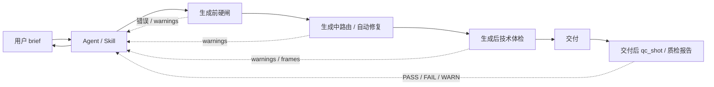
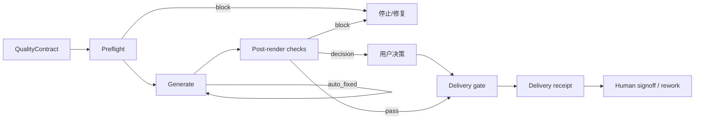

# Canvas Studio Skill 系统质量检测机制评审与目标态方案

> 日期：2026-10-23  
> 性质：设计评审 + 目标态方案。**只读文档，未改任何代码。**  
> 范围：`canvas-studio/skills/`、`canvas-studio/src/` 中与质量检测、校验、路由、交付反馈相关的机制。  
> 方法：静态代码核查 + 文档核查。所有现状判断均给出文件位置；目标态部分是设计决策，不冒充已实现事实。  
> 基线：当前工作树（含未提交的 CV-360 manifest 截断检测、CV-362 `inspect_image` 改动）。  
> 结论口径：本文把“质量”拆成**合同有效性、技术质量、内容质量、合规质量、性能质量**五类，不再用一个“质检”概念混装。

---

## 0. 执行摘要

### 0.1 一句话结论

**当前系统是一个成熟的“生成合同 + 技术护栏”系统，但还不是一个完整的“质量验收”系统。**  
它很擅长阻止“生成失败、结构错误、素材缺失、分辨率不够、没有声音”，但不擅长回答“这张图/这条视频是不是用户想要的”，而且大量质量结论只到达 agent，没有可靠到达用户。

### 0.2 五个关键判断

1. **质量责任错位**：机器能证明的事情（结构、素材、时长、分辨率、音轨）做得较好；机器不能证明的事情（内容是否符合预期、文字是否逐字正确、风格是否好看）被交给了不可靠的 VLM 和模型自检。
2. **视频内容质量基本没有自动检测**：只有技术体检、动效 lint、幻灯片风险评分和 `video2vl` 自由文本描述，没有“镜头内容是否符合分镜”的结构化验收。
3. **文字只检测输入，不验证输出**：`extractTextSpec` 是 prompt 侧启发式，不是图片侧 OCR；走文字模型后没有可靠的逐字验收。新增的 `inspect_image` 只做 PNG 的像素几何/主色，不做 OCR。VLM 对非 ASCII 文字的不可靠性已被代码注释明确承认。
4. **反馈通道是单点故障**：大部分 warning 进入工具结果，依赖 agent 转述；少量进入 toast / 时间轴；没有统一的“交付体检”面板。普通用户经常看不到、也看不懂。
5. **`qc_shot` 的语义自相矛盾**：交付后才跑、FAIL 不返工、auto 模式直接跳过、`budget/attempts/exhausted` 仍是旧自动返工模型的残留。它现在更像“参考报告”，不是“质量闸”。

### 0.3 目标态一句话

**建立一份项目级 `QualityContract`，让机器只对可验证事实做 PASS/FAIL，让用户只对主观内容做签收，让 agent 只负责解释和补救；所有质量结论以统一事件模型进入一个“交付体检”面板，而不是散落在 toast、工具行和对话里。**

这不是“再加几条 warning”。这是把质量体系从“检测集合”重构成“契约 → 证据 → 决策 → 签收”的闭环。

---

## 1. 现状总图



现状的关键特征：

- **检测点很多，但分布在不同层，语义不统一。**
- **硬闸和软提示混在一起**，用户无法判断“这条到底要不要处理”。
- **质量结果主要面向 agent**，不是面向用户。
- **内容质量主要靠 VLM 和 skill 自检**，没有可审计的签收。
- **交付后才做 `qc_shot`**，导致“质检”发生在用户已经拿到成片之后。

---

## 2. 现状检测机制全清单

### 2.1 生成前 / 落盘前：硬闸

| # | 检测 | 位置 | 触发 / 判定 | 反馈 | 用户可读性 | 评价 |
|---|---|---|---|---|---|---|
| 1 | 参数占位守卫 | `src/param-guard.ts:270`、`:294` | 入参含 `TODO`、`xxx`、`待定` 等占位值 → 抛 `CS-PARAM-002` | 工具失败，agent 收到错误 | 中 | 必要，防昂贵接口空跑 |
| 2 | 文本占位守卫 | `src/text-guard.ts:169`、`:249` | 旁白 / 故事板 / 入参是占位文本 → 拒收或清洗 | 工具失败 / 载入清洗 | 较高 | 必要 |
| 3 | 故事板完成度 | `src/contracts/storyboard.ts:810` | `blockers` 缺标题/画幅/时长/token/分镜/shot 字段/引用/角色 `lockedPrompt`/ID 唯一性；`warnings` 缺 `promptEn`、时长偏差、待核实事实、待上传素材 | 确认清单 | 中 | 必要，但只是“能不能落地”，不是“好不好” |
| 4 | H3-IR 校验 | `src/h3-ir-validate.ts:152`、`:738` | 六段结构、模式、段名、运镜词表、数值区间、素材编号 | 工具入口拦截 / warning | 低 | 对 H3 必要；只覆盖 H3 链路 |
| 5 | Manifest 结构校验 | `src/remotion/manifest.ts:1096` | id/meta/宽高/fps/帧数/轨道 id/时间字段/transform/animate/orbit/fx/exit/blend/colorShift 等；另有 `manifestTruncationError`（`:1476`）拦“总时长大于轨道最大结束帧”的尾部截断 | `render_composition` 失败或 warnings | 低 | Remotion 规范的核心硬闸；截断检测是 CV-360 的真机教训 |
| 6 | 素材完整性 | `src/remotion/asset-check.ts:134` | 缺失、非同源 URL、未物化 → `missing`，硬失败；ffprobe 探真实时长/像素 | 工具失败 | 中 | 必要，防静默 404/黑帧 |
| 7 | Look 卡完整性 | `look_card` 工具 | 缺 5 项 tokens 时 warning，仍落卡 | 工具结果 warning | 低 | 有价值，但用户不知道“5 项 tokens”是什么 |
| 8 | 审批门禁 | `src/approval-gate.ts` | 按状态/模式/工具决定是否允许 | 工具失败 | 中 | **不是质量检测**，是安全/流程闸 |
| 9 | Skill 导入校验 | `src/skill-import-validate.ts:194` | 文件数/大小/入口/frontmatter/slug/分类/图标 | 导入错误 | 中 | 检查包结构，不检查内容质量 |

**这一层的共同特点：**

- 大多数是**必须有的防呆**，尤其是参数/文本占位、素材缺失、Manifest 结构。
- 但很多错误文案是 agent/开发者语言，不是用户语言。
- `validateForSeed` 已经区分 blockers / warnings，是现有体系里最接近“用户决策清单”的机制，值得作为目标态的样板。

### 2.2 生成中：确定性守卫与路由

| # | 检测 | 位置 | 触发 / 判定 | 反馈 | 用户可读性 | 评价 |
|---|---|---|---|---|---|---|
| 10 | 文字提取 / 模型路由 | `src/text-detection.ts:209`、`src/model-route.ts:105` | 引号内、未被否定的文字 → 路由 Qwen 文字模型；否则 Krea2 | 路由原因进日志/warnings | 低 | 输入启发式，不是输出验收 |
| 11 | 非 ASCII 自动修字 | `src/text-detection.ts:236`、`:283` | 未走文字渲染链路且含非 ASCII 引号文本 → 自动 `image_fix` | 自动发生，用户未必知道 | 低 | 有价值，但缺少“已自动修复”的可见回执 |
| 12 | 提示词形态 | `src/prompt-shape.ts` | 行数/字符数/IR 段名 → `short/long/ir` | UI 折叠 | 无感 | **不是质量检测**，是展示形态 |
| 13 | 风格冲突 | `src/style-conflicts.ts:204` | 词表检测色彩/光线/景深/媒介/画幅冲突 | warning，不改 prompt | 中低 | 有价值但启发式，容易误报；用户不知道以谁为准 |
| 14 | 自动修字开关 | `src/host-tools.ts:1498` | `autoFixText` 默认开；走文字渲染链路时关闭 | 用户不一定知道 | 低 | 逻辑合理，但缺少可见证据 |

**这一层最关键的问题：**

- “是否含文字”是**prompt 侧启发式**，不是画面侧事实。
- 用户不把文字写进引号，就可能不走文字模型。
- 用户把风格词写进引号，就可能被误判为文字需求。
- 走 Qwen 后没有 OCR 或可靠验收；走非文字链路时自动修一次，但修没修对没有闭环。

### 2.3 生成后：技术体检与观感体检

| # | 检测 | 位置 | 触发 / 判定 | 反馈 | 用户可读性 | 评价 |
|---|---|---|---|---|---|---|
| 15 | 视频轨时长校正 | `src/remotion/timing.ts:228` | ffprobe 真实时长 vs 声明帧数，偏差大 → warning，并按真值修正 | 工具结果 warning | 低 | 必要，内部修正 |
| 16 | 分辨率上采样 | `src/remotion/resolution-check.ts:39` | `scale > 1.05` → warning；只判 video 轨；draft 按半分辨率 | 工具结果 warning | 高 | 必要，文案是现有体系里最好的样板之一 |
| 17 | 动效 lint | `src/remotion/motion-lint.ts:121` | `ML-01`…`ML-12`：同帧开始、硬切消失、动画过短/过长、linear、转场过短、同帧过多、无退场、出画、静态占比、字幕行数/长度 | `[编排体检 ML-xx]` warning，上限 12 条 | 低 | 抓“合法但难看”，性价比高；但编号和数量需要降噪 |
| 18 | 幻灯片风险 | `src/remotion/slideshow-risk.ts:103` | 6 维评分 ≥60 → warning；区分 `slideshow` / `card-based` | 工具结果 warning | 较高 | 最接近“视频是否符合预期”的结构化判断，但仍不是内容理解 |
| 19 | 音轨 / 合成 warning | `src/compose.ts:562`、`:611`、`:637` | 无法探测时长、旁白短于成片、无法探测混入音源、无音轨静片等 | 工具结果 `⚠️` + `StudioFrame.tsx:1940` toast | 高 | 必要；但 warning 被当成 `error` 弹 toast |
| 20 | 字幕时间对齐 | `src/remotion/timing.ts:176` | 字幕末帧与旁白总帧偏差 >0.5s | warning | 低 | 内部技术提示 |
| 21 | 渲后抽帧 / 报告 | `src/host-tools.ts:2780`、`:2786` | 返回 4–8 张帧 + 质量档/帧数/耗时/码率/lint 计数 | 工具结果 + 前端 | 中 | **文本模型不能直接看图**，`frames[]` 更像给人看的 |
| 22 | `inspect_image` 像素分析 | `src/inspect-image.ts`、`src/host-tools.ts:2996` | 零依赖解码 PNG；`profile` / `bbox-dark` / `bbox-bright` / `colors`；给尺寸、亮度包围盒、主色 | 工具结果文本 | 中 | **确定性像素真值**，可核对构图/位置/主色；但不是 OCR，也不判断内容语义 |
| 23 | 渲染性能报告 | `src/host-tools.ts:332` | `quality/frames/totalMs/msPerFrame/encodeMs/bytes/bitrate/warm` | 工具结果 | 低 | 性能信息，不是内容质量 |

**这一层的关键问题：**

- 技术体检做得比内容体检扎实。
- 动效 lint 和幻灯片风险是“观感启发式”，不是“内容理解”。
- 抽帧被要求“先看再汇报”，但主模型是文本模型；这形成了一个**视觉验收盲区**。

### 2.4 内容质量与交付质检

| # | 检测 | 位置 | 触发 / 判定 | 反馈 | 用户可读性 | 评价 |
|---|---|---|---|---|---|---|
| 24 | `qc_shot` 单镜一致性 | `src/host-tools.ts:1732`、`src/quality-check.ts:344` | VLM 对照 `expect` / 资产卡 `lockedPrompt` → PASS/FAIL/WARN + 漂移项；支持 `facesVisible`、`shotFocus` | 工具结果 + 写回节点 `qc` | 中 | 有价值，但交付后运行、不返工、auto 跳过、VLM 不可靠 |
| 25 | `image2vl` | `src/host-tools.ts:2084` | 图片描述 | 自由文本 | 中 | 分析工具，不是质检；文字识别不可靠 |
| 26 | `video2vl` | `src/host-tools.ts:2121` | 视频内容/运镜/节奏描述 | 自由文本 | 中 | 没有结构化 rubric，不是质检 |
| 27 | Skill 自检清单 | `skills/*/references/*checklist*.md` | 交付前人工/模型逐条检查 | 无机器回执 | 低 | 主观质量唯一可用的方式，但不可审计 |
| 28 | 开发自测 | `src/auto-test-checkpoints.ts:191`、`src/auto-test-report.ts:140` | 客观断言 | 测试报告 | 开发用 | 不是用户质检 |

### 2.5 当前反馈路径

现状有三条路径，但没有一条是“质量事实源”：

1. **工具结果 → agent → 用户**
   - `warnings` 进入工具结果文本；schema 要求“非空时必须告知用户”。
   - 问题：agent 是单点故障；它可能漏说、概括、说错。
2. **客户端直接提示**
   - 故事板确认清单：`validateForSeed`。
   - 成片合成：`StudioFrame.tsx:1940` 逐条 `pushToast(warning, 'error')`。
   - 时间轴：`CanvasTimeline.tsx:237` 显示 `composeWarnings`。
   - 工具行展开：用户可看原始输出。
   - 问题：覆盖不完整；warning 被当成 error；没有统一面板。
3. **交付后《质检报告》**
   - `qc_shot` 汇总，随交付输出。
   - 问题：事后报告，不触发返工；auto 模式还可能没有。

### 2.6 用户可理解性现状

**现有文案中做得好的：**

- “旁白比成片短 1.2 秒，末段将无旁白；如需覆盖全片请延长旁白或用 `cut_audio` 补齐。”
- “素材只有 864×480，成片 1280×720，上采样约 1.48×，细节在出片时已丢失。”
- “成片偏向幻灯片：静态画面占比过高、运动与镜头数不足。”
- “本次合成无任何音轨，成片将为静片。”

这些是“现象 + 影响 + 动作”，普通用户能理解。

**现有文案中做得差的：**

- `CV-214`、`CS-PARAM-002`、`ML-01`、`O-12`、`H3-Context-IR`
- `lockedPrompt`、`manifest`、`startAfter`、`tracks[0]`、`promptEn`
- “漂移项”“放手跑”“编排体检”“语义 ID”“视觉 token”
- “质检 FAIL，但不触发返工”——语义矛盾，用户不知道要不要处理。

---

## 3. 现状问题分级

### P0：会让“质量体系”失去可信度

#### P0-1 概念混装

“硬校验”“警告”“建议”“VLM 参考”“用户确认”都被叫成“质检”。  
结果是：用户不知道 `FAIL` 是“不能交付”还是“仅供参考”；开发者也不知道某个 warning 该不该阻断。

#### P0-2 视频内容质量没有真正检测

当前只有：

- 技术检查（素材、时长、分辨率、音轨）
- 结构/观感启发式（motion lint、slideshow risk）
- `video2vl` 自由文本
- 用户自己看抽帧

缺少：镜头内容是否符合分镜、主体是否一致、文字是否正确、节奏是否匹配、旁白是否覆盖。  
**这是“视频是否符合预期”最大的缺口。**

#### P0-3 文字只检测输入，不验证输出

`extractTextSpec` 是 prompt 侧启发式；`routeImageModel` 只决定模型；自动 `image_fix` 只修一次；没有 OCR/逐字验收。  
VLM 对非 ASCII 文字的不可靠性已在 `host-tools.ts:2084` 明确标注。  
所以“文字正确”目前是一个**未经验证的假设**，不是质量结论。

#### P0-4 反馈没有单一事实源

质量结果散落在工具结果、toast、时间轴、对话、节点字段里。  
用户看不到完整清单；agent 漏说就消失；不同入口的文案还可能不一致。

### P1：会造成流程矛盾和用户困惑

#### P1-1 `qc_shot` 的定位自相矛盾

- 工具描述：交付后使用，FAIL 不返工。
- 输出 schema：`budget` 是“重跑预算”，`exhausted` 是“停止自动重跑”。
- auto 模式：直接 `skipped`。
- skill：交付后出《质检报告》。

这四件事放在一起，用户无法理解：到底有没有质检？FAIL 了要不要改？为什么有预算但不重跑？

#### P1-2 auto 模式静默跳过

`quality-check.ts:25` 明确说 auto 模式逐镜质检关闭。  
但 skill 又要求交付后出报告。实际结果可能是：auto 模式没有报告，或者报告为空。  
如果产品把 auto 当作“放手跑”，用户仍会期待某种交付体检。

#### P1-3 抽帧检查对文本模型不可执行

`render_composition` 说“先看这几张图再向用户汇报”，但 `image2vl` 工具描述说主模型是文本模型、不能直接看图。  
除非再逐帧调 `image2vl`，否则 agent 没有可靠的视觉判断。  
**“抽帧验收”目前更像给人看的，不是机器闭环。**

#### P1-4 提示词规范不统一

- H3 有强校验。
- Krea2 / MJ / 其他风格主要靠 skill 自检。
- `prompt-shape` 只是形态判断。
- `style-conflicts` 只是词表冲突。
- 缺 `promptEn` 只是 warning。

所以“提示词规范”在不同链路上的严格程度差异很大，用户无法预期。

#### P1-5 skill 清单不可审计

skill 里的 checklist 是 prose，模型可以跳过、概括、漏项。  
交付时没有“哪些检查过、哪些没检查、依据是什么”的回执。  
这让“skill 质量”停留在信仰层。

### P2：噪音与体验问题

- `motion-lint` 最多 12 条，编号直接暴露给用户。
- warning 用 `error` toast，造成“失败”错觉。
- `style-conflicts` 词表启发式，误报会让 agent 和用户都学会忽略。
- `H3-IR` 的数值/编号 warning 对普通用户无意义。
- `render` 性能报告（msPerFrame、码率）不是用户质量语言。

---

## 4. 根因分析

### 4.1 把“质量”当成一个维度

质量至少分五层：

1. **合同有效性**：参数、结构、引用、格式是否合法。
2. **技术质量**：素材、分辨率、时长、音轨、渲染是否成功。
3. **内容质量**：是否符合用户意图、分镜、品牌、叙事。
4. **合规质量**：版权、商标、真实性、授权、平台政策。
5. **性能质量**：耗时、码率、成本、缓存。

这五层的 owner、证据、决策方式完全不同。  
当前系统把它们都叫“质检”，导致严重度和责任错位。

### 4.2 把“warning”当成一种严重度

`warning` 现在既表示“建议”，也表示“需要用户决定”，还表示“技术降级”。  
用户无法从词本身判断该做什么。  
目标态应使用**动作导向的严重度**：`block` / `decision` / `auto_fixed` / `info`。

### 4.3 把“agent 转述”当成反馈通道

agent 是解释者，不是传输层。  
质量结论必须有独立的持久化和 UI 出口；agent 漏说不能导致事实消失。

### 4.4 把“VLM 文本”当成事实

VLM 对文字、抽象风格、精确细节不可靠。  
它可以提供**证据和线索**，不能单独做验收结论。

### 4.5 把“结构合法”当成“内容合格”

Manifest 合法、故事板完整、素材存在，只能说明“可以生成”，不能说明“生成得对”。  
当前系统在这两者之间缺少一层“内容验收”。

---

## 5. 目标态方案

### 5.1 设计公理

目标态必须满足以下不变量：

1. **机器只对可验证事实做 PASS/FAIL。**
2. **内容质量只能由用户签收；VLM 只提供证据/参考，不单独判定通过。**
3. **每个质量结论必须有 owner、evidence、action。**
4. **用户只被要求处理需要决策的事项；其余折叠。**
5. **自动修复必须可见、可撤销、可复核。**
6. **质量契约先于生成，交付验收后于生成。**
7. **不再增加没有 owner 的 warning。**

### 5.2 质量分层与所有权

| 层 | 回答的问题 | Owner | 典型判定 | 是否阻断 |
|---|---|---|---|---|
| 合同有效性 | 参数/结构/引用合法吗？ | 系统 | `block` | 是 |
| 技术质量 | 能渲染、能播放、分辨率/音轨够吗？ | 系统 | `block` / `decision` / `auto_fixed` | 视契约 |
| 内容质量 | 符合用户意图、分镜、品牌吗？ | 用户 + VLM 证据 | `decision` | 不自动阻断 |
| 合规质量 | 版权/商标/真实性/授权吗？ | 用户 + 系统规则 | `block` / `decision` | 是 |
| 性能质量 | 成本/耗时/码率合理吗？ | 系统 | `info` | 否 |

### 5.3 引入项目级 `QualityContract`

这是目标态的核心。  
质量不是全局常量，而是**项目上下文**：草稿档和交付档、有无旁白、是否品牌片、文字是否关键，验收标准不同。

#### 5.3.1 契约内容

```ts
interface QualityContract {
  id: string
  projectId: string
  skillId?: string
  deliveryTier: 'draft' | 'standard' | 'high'
  checks: QualityCheck[]
  signoff: {
    requiredFor: 'delivery' | 'none'
    allowConditionalDelivery: boolean
  }
}

interface QualityCheck {
  id: string
  category: 'contract' | 'technical' | 'content' | 'compliance' | 'performance'
  severity: 'block' | 'decision' | 'info'
  owner: 'system' | 'user' | 'agent'
  method: 'deterministic' | 'vlm' | 'human' | 'ocr' | 'probe'
  title: string        // 用户语言
  threshold?: unknown  // 分辨率、时长、文字关键级等
  evidence: 'required' | 'optional' | 'none'
}
```

#### 5.3.2 契约从哪来

- 用户 brief：时长、画幅、语言、品牌、文字、交付档。
- skill 模板：该风格的固定验收项。
- 系统默认：结构、素材、音轨、渲染。
- 用户在开工时确认一次，之后可调整，但调整要记录。

#### 5.3.3 为什么这能解决问题

- **不再有“全局 warning”**：每条检查都对应契约项。
- **阈值有上下文**：草稿档 720p 不是问题；交付档 720p 才是问题。
- **用户能理解**：契约可以用一句人话展示：“本片要求 1080p、有旁白、字幕不超 2 行、品牌名逐字正确。”
- **可审计**：交付时逐项对账，不靠 agent 记忆。

### 5.4 统一质量事件模型

```ts
type QualitySeverity = 'block' | 'decision' | 'auto_fixed' | 'info'
type QualityOwner = 'system' | 'user' | 'agent'

interface QualityEvent {
  id: string
  contractCheckId: string
  stage: 'preflight' | 'generate' | 'post_render' | 'delivery'
  severity: QualitySeverity
  title: string        // 一句话，用户能懂
  detail: string       // 发生了什么
  impact: string       // 对成片的影响
  action: string       // 下一步做什么
  owner: QualityOwner
  evidence: QualityEvidence[]  // 图/帧/文件/探针/OCR/对比
  code?: string        // 内部编号，默认折叠
}
```

严重度语义：

- `block`：不解决不能交付。
- `decision`：系统不能替用户决定，必须用户选择。
- `auto_fixed`：系统已修复，告知用户并允许复核。
- `info`：仅供参考，不需要行动。

不再使用模糊的 `warning` 作为用户可见严重度。

### 5.5 生命周期



关键变化：

- **交付前**完成所有机器检查和需要的用户决策。
- **交付后**只保留“交付回执”，记录检查项、证据、用户签收；不再在交付后突然宣布 FAIL。
- `qc_shot` 归入交付前的视觉一致性检查，而不是交付后的报告。

### 5.6 交付体检 UX

交付时展示一个统一面板，固定四个区块：

```text
交付体检

✅ 系统已确认（8）
  · 素材完整、时长一致、无静音、分辨率达标

🔧 已自动处理（2）
  · 第 3 镜文字已自动修复（查看前后对比）

⚠️ 需要你决定（3）
  · 第 2 镜角色发型与资产卡不一致（查看抽帧）
  · 品牌名识别置信度低（查看文字裁切）
  · 动效覆盖偏低，可能偏幻灯片（查看建议）

ℹ️ 仅供参考（5）
  · VLM 对第 4 镜的描述、动效 lint 其余建议

⛔ 未检查（2）
  · 视频语义是否符合分镜（需你确认）
  · 品牌授权真实性（需你确认）
```

每个 `decision` 项只有一个主行动：

- “接受并交付”
- “按建议修复”
- “换一种方案”
- “先不交付”

这就是用户能理解的“质检”。

### 5.7 图片质量目标态

#### 机器可验证

- 文件可解码、尺寸、画幅、格式。
- 素材引用存在。
- 构图/位置/主色：`inspect_image` 给确定性像素真值（PNG 的 bbox / 主色 / 尺寸）。它能证明“元素在不在那个区域、主色是不是那个色”，不能证明“内容对不对”。
- 角色/场景一致性：VLM 对照 `lockedPrompt`，输出 `pass/uncertain/fail` + 证据；`uncertain` 进 `decision`，不自动 `fail`。
- 文字：`TextSpec` + OCR/VLM + 用户确认（见 5.9）。`inspect_image` 只能辅助定位文字区域，不能识别字形。
- 风格 tokens：是否完整、是否注入；风格匹配只做 `decision`，不做硬判。

#### 用户签收

- 美学、品牌调性、叙事是否满意。
- 角色是否“像”、场景是否“对”。

#### 自动修复

- 文字错误：只修一次，保留 before/after，修完仍不确定就转 `decision`。
- 不做“VLM 说不对就自动重出”，因为会烧预算且可能把对的图改坏。

### 5.8 视频质量目标态

#### 机器可验证（硬/技术）

- 解码成功、时长、fps、分辨率。
- 音轨存在/静音/响度/削波。
- 黑帧、冻结帧、明显花屏。
- 字幕安全区、行数、单行长度。
- Manifest/素材/字体/渲染成功。

#### 结构化内容 rubric（VLM + 用户）

每镜按固定维度：

| 维度 | 证据 | 判定 |
|---|---|---|
| 镜头数 / 时长 vs 分镜 | manifest + storyboard | 机器可判 |
| 主体是否出现 / 是否一致 | 抽帧 + VLM | `pass/uncertain/fail` |
| 动作是否符合分镜 | 抽帧 + VLM | `uncertain` 为主 |
| 运镜是否符合 | 抽帧 + VLM | `uncertain` 为主 |
| 画面文字 | TextSpec + OCR/VLM | 关键文字必须用户确认 |
| 连续性 / 服装 / 场景 | 跨镜抽帧 + VLM | `decision` |
| 品牌/合规 | 人工 + 规则 | `decision` / `block` |

#### 证据

- 每镜首帧、末帧、转场中点。
- 交付时 contact sheet，带时间码。
- 用户点开可看原片片段。
- 抽帧 PNG 可用 `inspect_image` 做确定性 bbox / 主色核对（构图、元素位置、主色），但不能代替语义判断。

#### 判定原则

- 技术问题可以 `block`。
- 内容问题默认 `decision`，不自动 `fail`。
- VLM 输出必须带置信度和“参考”标签。
- 不用“AI 认为好看”做交付结论。

### 5.9 文字质量目标态

#### 5.9.1 一等公民 `TextSpec`

不再依赖“引号启发式”作为唯一事实源。  
目标态工具入参支持结构化文字规格：

```ts
interface TextSpec {
  content: string
  role: 'title' | 'logo' | 'legal' | 'caption' | 'decorative'
  critical: boolean
  position?: string
  font?: string
  size?: string
  color?: string
  language?: string
}
```

- 有 `TextSpec` → 路由 Qwen 文字模型，确定性强。
- 只有 prompt 字符串 → 解析引号作为 fallback，但标记 `confidence: low`，并提示 agent 补结构化规格。
- 这样解决“用户没写引号就不走文字模型”的漏检。

#### 5.9.2 输出验收

- `critical: true`（品牌名、标题、法务文案、logo）：必须 OCR/VLM 辅助 + **用户确认**，不允许自动 PASS。
- `critical: false`（装饰字）：OCR/VLM 检查；失败自动修一次；仍不确定 → `decision`。
- 证据：原图裁切、期望文字、识别文字、置信度、修复前后对比。
- 自动修字只修一次，不循环；修完仍不确定就停下来问用户。

#### 5.9.3 用户文案

> “画面中的品牌名应为「XX」，系统识别为「XY」，置信度低。请核对裁切图后选择：接受 / 重新修字 / 重出该镜。”

这比“VLM 说文字不对”有用得多。

### 5.10 提示词质量目标态

#### 分模型契约

| 链路 | 硬要求 | 软要求 |
|---|---|---|
| H3-IR | 六段结构、模式、段名、运镜词表、素材编号 | 叙事、镜头语言、风格 |
| Krea2 | 主体/动作/场景/风格可解析 | 光影、材质、构图 |
| Qwen 文字 | `TextSpec` 完整 | 排版、字体、位置 |
| 通用 | 不能含占位参数/占位文本 | 负面约束、参考图使用 |

#### 判定原则

- 结构问题 `block`。
- 创意/风格问题 `decision` 或 `info`。
- `prompt-shape` 只做 UI，不参与质量。
- `style-conflicts` 升级为“用户选择以谁为准”，不再只是 warning。
- `promptEn` 是否必须由 skill 契约决定：需要英文提示词的链路，缺失应为 `block`；不需要的链路，缺失为 `info`。

### 5.11 Remotion / 合成质量目标态

#### 硬闸

- Manifest 结构合法。
- Manifest 尾部完整：`meta.durationInFrames` 必须等于全部轨道最大结束帧；缩水即拒收（`manifestTruncationError`，CV-360）。
- 长片 manifest 走 `manifestPath` 文件通道，避免入参截断。
- 素材存在、可解码、同源。
- 字体存在、渲染成功。
- 交付档要求的时长/分辨率/音轨满足契约。

#### 决策闸

- 上采样 > 1.2×（standard/high）→ `decision` 或 `block`，由契约决定。
- 1.05–1.2× → `decision`。
- 动效 lint 命中的关键项（硬切消失、出画、同帧过多）→ `decision`。
- 幻灯片风险 ≥60 → `decision`。
- 旁白短于成片、无音轨但契约要求声音 → `block`。

#### 信息项

- 渲染耗时、码率、msPerFrame、缓存命中。
- 非关键 lint 建议。
- `frames[]` contact sheet。

#### 用户可见

- 给 3 条“最值得看”的建议，其余折叠。
- 抽帧带时间码，用户可直接对照。
- 不再要求文本模型“看图”；需要时显式调用 `image2vl`，并标注参考性质。

### 5.12 Skill 质量契约目标态

每个 skill 增加一份结构化质量契约（可以是 `references/quality-contract.md` 或 frontmatter 扩展）：

```yaml
quality_contract:
  - id: brand-logo-integrity
    category: content
    severity: decision
    owner: user
    method: human
    title: 品牌 logo 未被拉伸/裁切/重建
  - id: duration-match
    category: technical
    severity: block
    owner: system
    method: deterministic
    title: 成片时长与目标时长偏差 ≤ 0.5s
  - id: text-critical
    category: content
    severity: decision
    owner: user
    method: ocr
    title: 品牌名/法务文案逐字正确
```

规则：

- **机器可判的** → 工具/测试检查。
- **主观的** → 用户签收，必须留证据。
- **无法检查的** → 明确写 `not_checked`，不允许静默。
- 交付时按 skill 契约展示“通过 / 待确认 / 未检查”。

这解决“skill 清单是 prose，模型可以跳过”的问题。

### 5.13 反馈与文案规范

#### 用户文案四段式

1. **发生了什么**：一句事实。
2. **影响是什么**：对成片/交付的影响。
3. **建议动作**：一个主行动 + 备选。
4. **证据在哪**：抽帧/裁切/对比/文件。

#### 禁止

- 禁止把 `warning` 一律 toast 成 `error`。
- 禁止在用户文案里直接暴露 `CV-xxx`、`ML-xx`、`O-xx`、`CS-xxx`；这些放“详情”。
- 禁止说“质检通过”但实际没检查内容。
- 禁止说“FAIL”但不给行动。
- 禁止让 agent 成为唯一的信息通道。

#### 严重度映射

| 严重度 | UI | 是否打断 | 示例 |
|---|---|---|---|
| `block` | 红色 | 是 | 素材缺失、渲染失败、必须旁白但无音轨 |
| `decision` | 琥珀色 | 是 | 文字置信度低、角色不一致、上采样 |
| `auto_fixed` | 蓝色 | 否 | 文字已自动修复、时长已校正 |
| `info` | 灰色 | 否 | 动效建议、性能数据 |

### 5.14 可观测性

质量体系必须能回答：

- 每个项目有多少 `block/decision/auto_fixed/info`？
- 哪些检查最常失败？
- 哪些 warning 被用户忽略？
- 自动修复的接受率/返工率？
- VLM 判定的假阳性/假阴性趋势？
- 交付平均被哪些 decision 拖慢？

建议记录 `QualityEvent` 的生命周期：产生、展示、用户选择、最终结果。  
这不是“监控”，是质量体系自我修正的依据。

---

## 6. 需要拍板的事项与建议

以下每项都给明确建议。建议不是“临时方案”，而是目标态的一部分。

| # | 拍板事项 | 建议 |
|---|---|---|
| D1 | 是否引入项目级 `QualityContract` | **引入**，作为质量唯一事实源 |
| D2 | `qc_shot` 的最终定位 | **交付前一致性检查 + 按需工具**，不叫质检、不自动返工 |
| D3 | auto 模式质量策略 | **做交付抽样体检**，并明确披露“未做逐镜内容质检” |
| D4 | 视频语义质检边界 | **结构化 rubric + 抽帧证据 + 用户签收**，拒绝 VLM 自动 PASS/FAIL |
| D5 | 文字输出验收 | **TextSpec 一等公民 + OCR/VLM 辅助 + 关键文字用户确认** |
| D6 | 技术阈值是否阻断交付 | **按契约阻断**：客观失败 block，审美问题 decision |
| D7 | 反馈入口是否统一 | **统一“交付体检”面板**，toast 只用于 block/decision |
| D8 | Skill 清单如何落地 | **结构化质量契约**：机器项自动、主观项签收、未检查项披露 |
| D9 | 提示词校验严格边界 | **H3 结构硬校验；其他链路只做完整性/矛盾/文字规格** |
| D10 | 旧语义是否清理 | **清理用户可见的 budget/CV-214/auto skipped 语义** |
| D11 | 是否开工时展示验收标准 | **展示**，交付时逐项对账 |

### D1. 是否引入项目级 `QualityContract` 作为质量唯一事实源

- **选项 A**：继续用零散 warning。
- **选项 B**：引入项目级 `QualityContract`，所有检查引用契约项。
- **建议：B。**
- **理由**：没有契约，就无法解决“草稿档 720p 不是问题、交付档 720p 是问题”这种上下文差异；也无法让用户理解“这条检查为什么存在”。
- **拍板后影响**：需要定义契约模板、skill 契约、交付体检 UI；这是架构级改动，但也是唯一能同时解决噪音、责任、可理解性的方案。

### D2. `qc_shot` 的最终定位

- **选项 A**：保持“交付后参考报告”，不返工。
- **选项 B**：改为“交付前视觉一致性检查”，FAIL/不确定进入用户决策。
- **选项 C**：只作为按需工具，不进入交付流程。
- **建议：B + C。**
  - 交付前对高风险镜头（角色、文字、品牌、关键道具）自动跑；其他镜头可按需跑。
  - 结果命名“一致性检查”，不叫“质检”。
  - `FAIL` 不自动重跑；进入 `decision`，由用户选择“接受 / 重出 / 修图”。
- **理由**：交付后才发现问题，用户已经拿到成片；不返工又用 FAIL 语气，语义矛盾。
- **拍板后影响**：`qc_shot` 的时机、文案、输出 schema 要调整；`budget/attempts/exhausted` 需要退出用户可见模型。

### D3. auto 模式的质量策略

- **选项 A**：继续逐镜跳过，不承诺内容质检。
- **选项 B**：auto 模式仍做“交付抽样体检”：抽帧 + 技术检查 + 可选 VLM，明确标注“未做逐镜内容质检”。
- **建议：B。**
- **理由**：auto 是“放手跑”，不是“放弃验收”。至少要让用户知道哪些检查了、哪些没检查。
- **拍板后影响**：auto 模式需要一条轻量交付检查链路，不能静默 `skipped`。

### D4. 视频语义质检的边界

- **选项 A**：不做，靠用户自己看。
- **选项 B**：做结构化 rubric + contact sheet + VLM 参考 + 用户签收。
- **选项 C**：让 VLM 自动判 PASS/FAIL。
- **建议：B，明确拒绝 C。**
- **理由**：VLM 不能可靠判断“内容是否符合预期”；但可以整理证据、标出不确定项。自动 PASS/FAIL 会制造虚假信心。
- **拍板后影响**：需要定义视频 rubric、抽帧策略、contact sheet、用户签收流程。

### D5. 文字输出的验收方式

- **选项 A**：继续信任路由 + 自动修字。
- **选项 B**：`TextSpec` 一等公民 + OCR/VLM 辅助 + 关键文字用户确认。
- **选项 C**：只靠 OCR 自动判。
- **建议：B。**
- **理由**：OCR 对中文、艺术字、排版文字也可能错；关键文字必须用户确认。非关键文字可以自动修一次，但不能假装逐字正确。
- **拍板后影响**：工具入参、路由、自动修复、交付 UI 都要改；这是解决“是否含文字/文字是否正确”的根本方案。

### D6. 技术阈值是否阻断交付

- **选项 A**：全部 warning，不阻断。
- **选项 B**：按契约阻断：素材缺失/渲染失败/必须旁白但无音轨/时长偏差过大 → `block`；上采样 >1.2× → `block`（standard/high）或 `decision`（draft）；动效/幻灯片 → `decision`。
- **建议：B。**
- **理由**：技术问题有客观答案，应该阻断；审美问题没有客观答案，应该让用户决定。
- **拍板后影响**：需要定义交付档阈值；用户可在项目开始时选择草稿档，避免误伤。

### D7. 反馈入口是否统一

- **选项 A**：继续 toast + 工具行 + 对话。
- **选项 B**：统一“交付体检”面板为事实源；toast 只用于 `block` / `decision` 的即时提醒。
- **建议：B。**
- **理由**：没有单一事实源，用户永远不知道“还有没有别的检查”。
- **拍板后影响**：需要 UI 面板、事件持久化、agent 文案与面板共用同一数据。

### D8. Skill 清单如何落地

- **选项 A**：继续 prose checklist。
- **选项 B**：skill 提供结构化质量契约；机器项自动检查，主观项用户签收，未检查项明确披露。
- **建议：B。**
- **理由**：prose 清单不可审计，模型可以跳过；结构化契约才能交付时对账。
- **拍板后影响**：每个 skill 需要补质量契约；需要统一模板和验收方式。

### D9. 提示词校验的严格边界

- **选项 A**：所有链路都做强校验。
- **选项 B**：H3 结构硬校验；其他链路只做“完整性/矛盾/文字规格”检查，创意质量交给用户。
- **建议：B。**
- **理由**：不同模型对提示词形态要求不同；用一套强校验会误杀创意。
- **拍板后影响**：H3 保持现状；其他链路的 warning 要重新分级。

### D10. 旧语义是否清理

- **选项 A**：保留 `budget/attempts/exhausted`、`CV-214`、`auto skipped` 文案。
- **选项 B**：从用户可见契约中移除旧自动返工语义；内部日志可保留编号。
- **建议：B。**
- **理由**：这些是旧模型的残留，会误导 agent 和用户；保留只会增加解释成本。
- **拍板后影响**：工具 schema、文案、skill 文档要同步清理；需要一次兼容性迁移。

### D11. 是否把“质量契约”在开工时给用户看

- **选项 A**：只在交付时展示。
- **选项 B**：开工时展示一页“本片验收标准”，交付时对账。
- **建议：B。**
- **理由**：用户越早知道验收标准，越少在交付时惊讶；也能让“草稿档/交付档”的差异显式化。
- **拍板后影响**：需要一页可编辑的验收标准；默认由 skill + brief 生成。

---

## 7. 目标态落地顺序（不是临时方案）

目标态需要分阶段迁移，但每一阶段都是最终架构的一部分，不是打补丁。

### Phase 0：冻结语义与契约

- 定义五类质量、四种严重度、owner、evidence、交付状态。
- 定义 `QualityContract` / `QualityEvent` 的字段和文案规范。
- 选定 2 个 skill 作为契约模板试点（建议：`canvas-studio-creation` + 一个风格 skill）。
- **退出标准**：所有新检查都能映射到契约项；没有“无 owner 的 warning”。

### Phase 1：统一反馈与交付体检

- 建立质量事件持久化与“交付体检”面板。
- toast 只保留 `block` / `decision`。
- agent 文案与面板共用同一事件源。
- **退出标准**：用户能在一次交付中看到“已确认/已修复/需决定/未检查”四类。

### Phase 2：文字闭环

- 引入 `TextSpec` 一等公民。
- 路由从“引号启发式”升级为“结构优先、启发式兜底”。
- 关键文字 OCR/VLM 辅助 + 用户确认。
- 自动修字保留 before/after 证据。
- **退出标准**：关键文字不再有“系统说对了但没人确认”的状态。

### Phase 3：视频交付体检

- 技术硬检 + 抽帧 contact sheet + 结构化 VLM rubric。
- 内容项默认 `decision`，不自动 `fail`。
- auto 模式也产出抽样体检。
- **退出标准**：每条视频交付都有“技术通过/内容待确认/未检查”的明确状态。

### Phase 4：Skill 质量契约

- 每个 skill 补 `quality-contract`。
- 机器项接工具/测试；主观项接交付签收。
- 清理 prose checklist 中无法验证的“已检查”表述。
- **退出标准**：交付时能逐项对账 skill 契约。

### Phase 5：清理旧语义

- 移除用户可见的 `budget/attempts/exhausted`、`CV-214`、`auto skipped` 旧语义。
- 保留内部 issue code 作为日志/详情。
- **退出标准**：用户文案里不再出现内部编号，不再出现“FAIL 但不返工”的矛盾。

---

## 8. 验收标准

### 8.1 产品验收

1. 用户能回答四个问题：
   - 系统检查了什么？
   - 哪些没通过？
   - 哪些需要我决定？
   - 哪些根本没检查？
2. 每条 `block` 都有明确修复动作。
3. 每条 `auto_fixed` 都有 before/after 证据。
4. 任何内容质量维度都不会在未经用户确认时显示“通过”。
5. auto 模式明确披露“未做逐镜内容质检”。
6. 关键文字必须用户确认。
7. 视频交付有 contact sheet 和内容待确认项。
8. 交付后不再出现新的“质检 FAIL”惊吓；回执只记录已发生的检查与决策。

### 8.2 工程验收

1. 每个 `QualityEvent` 都能追溯到 `QualityContract` 的 check。
2. 同一事实只有一个来源；UI、agent 文案、报告不各写一套。
3. 每个检查有 owner、method、evidence。
4. 没有无 owner 的 warning。
5. 旧 schema 字段有明确废弃计划。
6. 质量数据可统计：block rate、decision rate、auto-fix rate、rework rate、ignore rate。

### 8.3 反例验收

以下情况出现即视为失败：

- 用户看到 `ML-01` 但不知道要做什么。
- 用户看到 `FAIL` 但系统说“不用返工”。
- 系统说“文字正确”但没有 OCR/用户确认。
- 系统说“质检通过”但视频内容没检查。
- auto 模式没有任何质量披露。
- 同一个问题在 toast、工具行、报告里三种说法。
- 新增一条 warning 但没有 owner/action。

---

## 9. 风险与非目标

### 9.1 风险

| 风险 | 影响 | 对策 |
|---|---|---|
| 用户决策疲劳 | 交付变慢 | 默认建议 + “接受所有低风险项” + 只展示前 3 条关键项 |
| VLM 仍不可靠 | 误报/漏报 | 只做证据，不做最终 PASS；关键项用户确认 |
| 抽帧/OCR 成本 | 延迟/费用 | 智能抽样：首末帧、转场、文字帧、低置信度帧 |
| 契约太重 | 用户不愿填 | 默认由 brief + skill 生成，用户只确认/改 |
| skill 作者负担 | 契约不完整 | 提供模板 + 机器可判项清单 |
| 旧字段兼容 | 迁移风险 | 保留一版 deprecated 映射，再移除 |

### 9.2 非目标

- 不追求“AI 自动判断好不好”。
- 不用更多启发式 warning 代替内容验收。
- 不把审美、品牌、叙事的主观判断伪装成机器结论。
- 不为了“看起来严格”而阻断合法创作。
- 不替代人类导演/品牌方的最终签收。

---

## 10. 附录

### 10.1 现状检测点索引

- 参数守卫：`src/param-guard.ts:270`、`:294`
- 文本守卫：`src/text-guard.ts:169`、`:249`
- 故事板：`src/contracts/storyboard.ts:810`
- H3-IR：`src/h3-ir-validate.ts:152`、`:738`
- Manifest：`src/remotion/manifest.ts:1096`
- 素材：`src/remotion/asset-check.ts:134`
- 文字检测/路由：`src/text-detection.ts:209`、`:236`、`:283`；`src/model-route.ts:105`
- 风格冲突：`src/style-conflicts.ts:204`
- 时长校正：`src/remotion/timing.ts:228`
- 分辨率：`src/remotion/resolution-check.ts:39`
- 动效 lint：`src/remotion/motion-lint.ts:121`、`:356`
- 幻灯片风险：`src/remotion/slideshow-risk.ts:103`
- 合成 warning：`src/compose.ts:562`、`:611`、`:637`
- 字幕对齐：`src/remotion/timing.ts:176`
- 抽帧/报告：`src/host-tools.ts:2780`、`:2786`、`:332`
- 像素分析：`src/inspect-image.ts`、`src/host-tools.ts:2996`
- `qc_shot`：`src/host-tools.ts:1732`、`src/quality-check.ts:25`、`:344`
- `image2vl` / `video2vl`：`src/host-tools.ts:2084`、`:2121`
- 反馈 UI：`src/client/StudioFrame.tsx:1940`、`src/client/canvas/CanvasTimeline.tsx:237`
- skill 质检报告规则：`skills/canvas-studio-creation/SKILL.md:63`
- 开发自测：`src/auto-test-checkpoints.ts:191`、`src/auto-test-report.ts:140`

### 10.2 用户文案对照表

| 现状 | 目标态 |
|---|---|
| `[编排体检 ML-01] startFrame=0：4 条轨在同一帧同时开始动画` | “开场有 4 个元素同时动，画面会显得没有主次。建议错开 3–6 帧。” |
| `CV-214：QC 不再触发自动重跑` | “这条检查发现画面可能与设定不一致。系统不会自动重做，请你决定是否重出。” |
| `CS-PARAM-002` | “这次调用还有占位参数（`xxx`），请先补全再生成。” |
| `O-12 上采样 1.48×` | “素材只有 864×480，成片是 1280×720，会变糊。建议重出 736p，或把成片降到 480p。” |
| `manifest.tracks[0].startFrame 必须...` | “时间轴第 1 条轨的起始时间不合法，已定位到具体轨道。” |
| `质检 FAIL` | “一致性检查发现 2 处不确定项，请确认是否接受。” |

### 10.3 术语表

- **合同有效性**：参数、结构、引用、格式是否合法。
- **技术质量**：素材、分辨率、时长、音轨、渲染是否满足契约。
- **内容质量**：是否符合用户意图、分镜、品牌、叙事。
- **合规质量**：版权、商标、真实性、授权、平台政策。
- **性能质量**：耗时、码率、成本、缓存。
- **QualityContract**：项目级验收契约，定义检查项、阈值、owner、证据。
- **QualityEvent**：一次检查结果，带严重度、证据、行动。
- **block**：不解决不能交付。
- **decision**：系统不能替用户决定。
- **auto_fixed**：系统已修复，需告知并可复核。
- **info**：仅供参考。

### 10.4 本文未做的事

- 未改任何代码。
- 未登记 CV 编号。
- 未替产品拍板；第 6 节是建议，最终需要产品/设计/工程共同确认。
- 未声称 VLM 可以可靠判断内容质量；相反，本文的核心建议是不要让它做最终验收。
